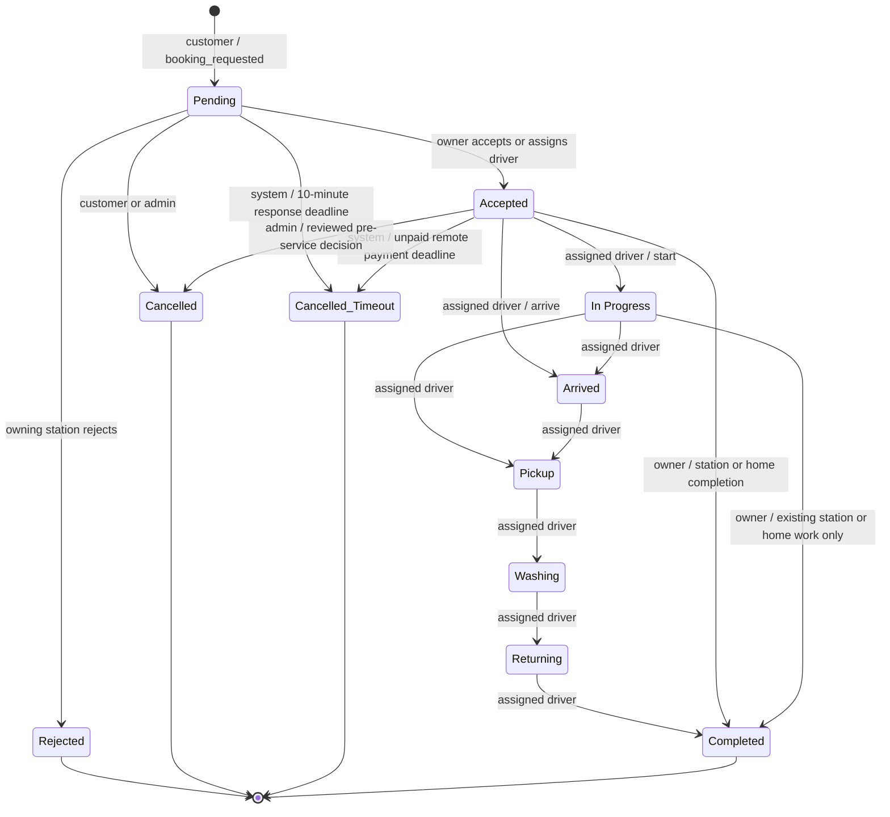

# CLEVO shared booking workflow

Subsequent integration phases (2026-11-16): [NOTIFICATIONS.md](NOTIFICATIONS.md), [TRACKING_ARCHITECTURE.md](TRACKING_ARCHITECTURE.md), and [NOTIFICATION_TEST_RESULTS.md](NOTIFICATION_TEST_RESULTS.md) describe migrations 007/008, current delivery/tracking policy and test evidence. The API now has 159 operations across 138 paths. Earlier phase counts and worker/null-transport behavior below are historical where superseded.

Subsequent payment phase (2026-11-16): [PAYMENT_INTEGRATION.md](PAYMENT_INTEGRATION.md) and [PAYMENT_TEST_RESULTS.md](PAYMENT_TEST_RESULTS.md) are authoritative for migration 006, the approved new-booking 5% commission in integer JOD fils, sandbox hosted checkout, verified funding, refunds, ledger and commercial blockers. The API now has 145 operations across 125 paths. Earlier phase counts and retained financial rules below are historical where superseded.

Implemented booking phase, 2026-11-16. PHP/mysqli, MySQL, the existing PHP pages, Arabic/English, themes and all four roles remain. Flutter is not built. No real database was migrated or reset. Validation uses isolated MariaDB copies; production deployment requires the checks below.

## One authoritative workflow

`booking.Status` and its committed service/price/schedule snapshots are authoritative for Customer, Owner, Driver and Admin. Browser state, submitted totals, payment-selection flags and notifications cannot change that authority. All application status UPDATEs now live in `clevo_booking_transition()` in [booking-workflow.php](../includes/booking-workflow.php). Creation still uses the existing shared `clevo_create_booking()` in [commerce.php](../includes/commerce.php). There is no replacement framework or second mobile booking engine.

| Entry point | Shared service / current files |
|---|---|
| Customer PHP Station Details / API create | `user/station-details.php`, `POST /api/v1/bookings` -> `clevo_create_booking()` |
| Customer cancel / reschedule | Existing PHP order/history adapters and API -> `clevoCancelBookingForUser()` / `clevoRescheduleBookingForUser()` in `includes/booking-helpers.php` |
| Owner service publication / prices / duration | `owner/manage-services.php` and owner API -> `clevo_market_service()` in `includes/marketplace.php` |
| Owner capacity, fees, hours, availability | Small settings form added to the existing services page; `PATCH /owner/stations/{id}/availability` -> `clevo_market_availability()` |
| Customer service catalog | `clevo_booking_services()` for PHP; equivalent scoped/paginated API projection from the same service rows and station duration default; archived services are excluded |
| Owner accept / reject / complete | Existing `owner/incoming-orders.php` and owner API adapters -> existing public helper names -> central transition service |
| Pickup/return assignment | Existing PHP owner form / owner API -> `clevo_market_assign()`; uses the central acceptance transition when necessary |
| Driver progression / API accept | Existing driver dashboard and `driver/jobs`/`driver/tasks` API aliases -> `clevo_driver_transition()` -> central transition service |
| Admin cancellation / refund approval | `POST /admin/bookings/{id}/cancel` and existing internal refund review -> central pre-service cancellation; no arbitrary status override |
| Expiry | `scripts/expire-bookings.php` and retained PHP compatibility calls -> `cancelExpiredBookings()` -> central system transition |
| State history | `booking_status_history`, `GET /bookings/{id}/events`; customer/owner scoped, accountable actor IDs visible to Admin |
| Notifications | Transactional `notification_outbox` -> post-commit delivery hook / `scripts/booking-notification-worker.php` -> existing notifications/read-marker APIs |

API paths in this document are relative to `/api/v1`. The generated [OpenAPI specification](openapi.v1.json), [endpoint inventory](API_ENDPOINT_INVENTORY.md) and [API guide](API_INTEGRATION.md) include the two added routes: booking events and administrator pre-service cancellation. There are now 127 method/path operations across 109 paths; this count includes compatibility aliases and authentication operations.

## Confirmed inconsistencies addressed

| Confirmed before this phase | Resolution / evidence location |
|---|---|
| `user/home.php` and `user/notifications.php` ran direct timeout UPDATEs after the shared expiry helper. These bypassed refunds/history and could leave a partially processed request. | Removed those UPDATEs; both pages retain only shared expiry. Repository status-write inspection now finds the single central booking status UPDATE. |
| Create serialized the station but never counted overlapping reservations; availability explicitly reported `capacity_enforced=false`. | Configured interval capacity is checked under a station lock for create/reschedule; availability provides an advisory exact-appointment quote. |
| Repeated requests with different keys could duplicate the same active intent. | Existing idempotency receipts plus a generated unique active-intent index; a second key for the same active intent resolves to the same booking. |
| Reschedule accepted times without station/mode/hours/capacity checks and used a different datetime parser. | Shared datetime/schedule/capacity rules, preservation of the booked quote/duration, atomic move or complete rollback. |
| Customer Station Details selected archived services and OR-ed service flags into station availability, while the backend required station flags. | Catalog excludes archived services and respects station modes. Explicitly publishing an owner service option enables that station mode in the same transaction; an availability update can disable it again. |
| Owner PHP service form did not persist a duration; new services could retain null duration. | Duration input added within the existing form; shared service validates/persists it. Missing legacy duration is displayed using the station's DB default. |
| Booking services snapshotted prices/names, but not duration, end time or additional fees. | New reservations snapshot all three and the subtotal. Later catalog changes do not reprice or resize booked work. |
| Status logic was spread between commerce, driver, assignment, customer and refund handlers. Driver graph allowed Arrived -> In Progress -> Arrived cycles. | One transition policy; monotone driver graph. Existing buttons remain, with impossible next actions disabled using the same graph. |
| Assignment checked driver ownership/activity but not time conflicts. | Same-station driver row and booking locks plus a one-job overlap check; started tasks cannot be reassigned. |
| Audit actions did not contain a structured from/to status, role and reason for every transition. | Append-only status events committed with the booking; no invented historical timeline. |
| Notifications were inserted inside business transactions. Although invisible to other connections until commit, there was no durable post-commit delivery mechanism. | Queue intent transactionally, trigger actual notification INSERT only after the outer commit, recover via worker; delivery INSERT and outbox marker commit together. |
| A legacy notification flag could suppress legitimate expiry. | Eligibility is based on status/deadline/payment; the flag is no longer an authority. |
| A duration window crossing closing time could be accepted if its start was within hours; cash/payment proof could be separated from lifecycle decisions. | Validate the full interval, keep typed receipt/entitlement proof inside completion/progression, and reuse atomic refunds/earnings/rewards. |

Existing financial rules retained: 10% stored commission, loyalty conversion, one plan wash per selected booking, wallet ledgers and owner reserve/payout behavior. This phase does not introduce coupon programs, a payment gateway, new bank settlement or an accounting system. Historical anomalies are reported for reconciliation; records are not silently repaired.

## Scheduling and capacity rules

- `station`: wash at the station. `home`: a crew performs the service at the customer's address. `delivery`: a driver picks up the vehicle, the station washes it, and the driver returns it. Pickup/return preserves its existing role and lifecycle; it is not treated as an at-home crew visit.
- Each booking consumes one resource unit. At-station and pickup/return share `stations.BookingCapacity`. Home crews use `HomeCapacity`. An assigned driver has capacity one. A booking's selected services run sequentially; their durations are summed. Up to the existing 30 distinct services are supported, provided every service belongs to the station and supports the requested mode.
- **No commercial capacity number was supplied.** Migration 005 leaves both capacities NULL rather than inventing one. Owners configure them explicitly through the existing services page or owner availability API. Missing capacity fails with 409 `station_capacity_not_configured` before creating a reservation. Configure all approved stations during the maintenance rollout; existing records are preserved. The limit is 1–1,000 units per pool.
- Service minutes come from `services.Duration`, otherwise `stations.DefaultServiceMinutes` (persisted DB default 30). Pickup/return also adds `DeliveryBufferMinutes` (DB default 0). New total duration must be 1–1,440 minutes. Owners must configure realistic crew/travel time; a route provider does not calculate it in this phase.
- Reservations are half-open intervals `[start, end)`. A 10:00–11:00 booking permits another at 11:00. Capacity uses **peak** simultaneous occupancy, not the number of rows that intersect a long interval. Multiple non-overlapping rows do not each consume a simultaneous unit.
- Creation locks the station, reads current service rows, computes the DB quote/duration, locks relevant active bookings and checks capacity before inserting snapshots/entitlement/events/idempotency records. Reschedule and assignment acquire the station before the booking. Independent requests serialize on that station even when the calendar was initially empty. All SQL values are parameterized; unique active intent and ledger/effect constraints provide additional protection.
- Pending, Accepted, In Progress, Arrived, Pickup, Washing and Returning reserve capacity. Rejected, Cancelled, Cancelled_Timeout and Completed release it. Reducing configured capacity preserves existing bookings; new requests fail while occupancy is at/above the new limit. A capacity setting cannot cancel history.
- Known unfinished work past its reserved end retains its resource with an unknown release time until legitimate completion/cancellation policy resolves it. Early driver start expands occupancy back to the actual start; start checks station/driver capacity for that expanded interval. An unstarted driver job whose slot has elapsed cannot be started. No traffic ETA or automatic travel-time extension is claimed.
- Every new request/reschedule must be in the future. The complete duration must fit within opening hours, including overnight windows. Equal opening/closing times preserve the existing 24-hour-open convention. Legacy missing hours retain the existing unrestricted-hours interpretation; operators should configure them.
- Civil date/time and timezone are retained alongside `ScheduledAtUtc` and `ScheduledEndAtUtc`. Server events use UTC and connections use `+00:00`. Booking timezone remains configured `BOOKING_TIMEZONE` (default `Asia/Amman`), not the device's locale. No timezone-table-dependent SQL conversion is required.

Legacy active bookings with valid civil appointments but missing duration/end are projected using the **current station DB default per historical service**, plus the pickup buffer. This projection is conservative policy, not a claim to know the original duration; it never writes a fabricated snapshot. Invalid/missing appointments fail with 409 `legacy_schedule_requires_reconciliation`, rather than being omitted from occupancy. Operators must review legacy durations and existing overlapping bookings on a restored production copy. Existing accepted records are not automatically cancelled or rescheduled.

Station capacity protects scheduled resources; it does not model individual bays, equipment, staff rosters, vehicle quantity or route optimization. The active-booking locking/sweep cost grows with that station's active schedule; benchmark actual production volumes before release.

## Server price and retry contract

Example owner setup (illustrative capacities, not deployment defaults):

```http
PATCH /api/v1/owner/stations/12/availability
Authorization: Bearer <owner-access-token>
Idempotency-Key: <one-stable-random-request-key>
Content-Type: application/json

{"capacity":3,"home_capacity":1,"default_service_minutes":30,"delivery_buffer_minutes":30,"station_fee":"0.00","home_fee":"2.00","delivery_fee":"3.00","has_home_service":true,"has_delivery":true}
```

An exact availability request is `GET /api/v1/stations/12/availability?date=2027-01-20&time=10:00&mode=delivery&service_ids=10,11`. `availability.appointment` contains `available`, peak capacity/remaining units, UTC start/end, duration, service subtotal, additional fee and total. It is advisory and does not reserve a unit; create/reschedule always repeat the transaction-safe check. Never treat a previous availability response as a guarantee.

`ServicesSubtotal = sum(selected DB prices)`, `AdditionalFee = DB StationFee/HomeFee/DeliveryFee`, and `Total_Price = subtotal + fee`, calculated in integer cents. Client price, total, fee, commission, duration, status and payment flags do not set these values. New `booking_services.DurationMinutes` and booking aggregate/end/subtotal/fee are immutable snapshots of the accepted creation quote; a Pending reschedule preserves that quote and duration while rechecking current service eligibility, hours and capacity.

Mode fees default to zero in the DB, preserving existing price behavior until an owner configures them. Loyalty discount is applied by the existing payment service to the server total. The existing plan policy covers the whole selected booking, including configured fees, and consumes one wash; it does not create a new per-service quota or separate uncovered fee debt. Changing that commercial policy needs a separate reviewed migration/payment design. The customer sees DB-derived service duration and a fee-inclusive preview in the existing interface, and must read the server booking/price breakdown before payment.

`Idempotency-Key` remains required for API create and sensitive commands. Repeating a committed key/input returns its saved result; changed normalized input with the same key is 409. Failed transactions do not consume a key. Canonical active intent additionally covers customer/station, sorted service IDs, mode, civil instant and relevant location/address. It excludes payment preference and unused station GPS/address, so changing a plan switch or switching location controls cannot manufacture another active reservation. The original booking/payment method is returned; read it rather than assuming a requested preference was applied. Coordinates are normalized to DB precision. A terminal booking releases the generated active-intent key, allowing a deliberate new reservation with a new request key.

This is one vehicle/unit per booking under the existing data model. Multiple cars at the same appointment are not represented by resubmitting the same intent; a future quantity/vehicle model would need explicit validation and capacity consumption. Browser request keys survive network retries within the page; changed form intent receives a new key. Refreshing the page does not bypass active-intent protection.

## State machine and accountability



| Actor | Permitted decisions / guards |
|---|---|
| Customer | Own Pending cancellation/reschedule. Cannot accept, assign a driver, complete, or bypass Accepted refund review. |
| Owner | Own approved, unarchived station only. Pending -> Accepted/Rejected. Assignment can accept Pending delivery. Station/home Accepted or legacy In Progress -> Completed with payment proof. Pickup/return completion belongs to its assigned driver. Acceptance requires active station, unexpired response window and a usable unelapsed new slot. |
| Driver | Active driver, matching station and exact assigned delivery job. Only the graph above; payment proof required. No backward Arrived -> In Progress, no completion skip, no terminal revival, no overlapping assignment. Task-code sessions retain their one-job scope. |
| Admin | Read the same resources/history; cancel Pending/Accepted before execution with a required reason. Existing refund review uses this cancellation path. Cannot forge provider payment, skip work to Completed or cancel started/completed work through this command. |
| System | Only genuine timeout transitions with fixed request/payment expiry reasons; no arbitrary unauthenticated status write. |

Every successful status change appends `BookingID`, from/to status, `ActorID`, normalized role, reason and microsecond UTC timestamp to `booking_status_history` in the same transaction. Creation records NULL -> Pending. Pending reschedules append a same-state event with reason `customer_rescheduled`; assignment changes additionally retain their existing assignment/audit history. Admin cancellation reason must be a bounded single-line explanation. Avoid confidential information in reasons exposed to the booking participants.

Existing rows do not receive a fabricated historical timeline: their first new event records the actual from/to transition. Runtime grants permit SELECT/INSERT, **not UPDATE/DELETE**, on status history. Database administrators are still privileged; this is not an external tamper-proof audit service. Safe repeated owner accept/reject/complete keeps its existing no-op behavior without another event, refund, reward or notification. Illegal transitions fail atomically with 409; inaccessible objects return 404. Invalid times/durations return 422 in the API.

## Cancellation, payment and expiry

- Preserve the existing customer policy: only Pending can be cancelled/rescheduled by the customer. Accepted work requires support/refund/admin review. The UI's current cancellation controls remain valid.
- Owner rejection applies only to Pending. System Pending expiry is ten minutes after original creation; rescheduling does not renew that response deadline. An unpaid home/pickup Accepted request expires ten minutes after acceptance. At-station cash has no invented remote-payment deadline. The expiry worker runs without a page visit and rechecks state under locks.
- Internal wallet, points and plan cancellation/rejection/expiry refund atomically restores the customer components and reverses structured owner earning once. Insufficient owner funds, inconsistent amount/currency/ownership or unproven legacy payment markers abort the transaction for reconciliation. No completed status is written before proof or refund work succeeds.
- Unpaid/pending station cash cancellation does not claim a cash refund. Authorized station completion records the owner's current manual cash-collection attestation. Existing typed wallet/points receipts or consumed same-customer plan entitlement prove execution; a payment-selection string alone does not.
- Started/completed services, external-provider payments and collected cash require manual/provider dispute handling. No card capture/refund or automatic wallet credit for an external-provider refund is fabricated. A terminal refund review may update the refund request without rewriting an already terminal booking to a different terminal status.
- Terminal transitions end current driver assignments, revoke task sessions/codes, retain DriverID/history, and release reservation/intent capacity. Completion rewards and payouts use the existing unique effect/ledger protection.

## Notifications after commit

Calls to existing notification helpers inside domain transactions enqueue `notification_outbox` rows instead of inserting customer-visible notifications. Nested service/savepoint success cannot dispatch them. An outer rollback removes both state history and notification intent. After the successful outer commit, a guarded delivery hook inserts each notification and its outbox delivery marker in a separate transaction. Concurrent workers lock/recheck the queue row, preventing duplicate DB notification delivery.

If delivery fails after the booking commit, the booking remains successful and the durable outbox stays pending. The response is not changed into a false booking failure and no refund is inferred. The scheduled notification worker retries committed pending records. Only exception class/generic diagnostics are logged; no notification payload, location, token or financial details are logged by these hooks. This guarantees durable DB inbox delivery/retry semantics, not exactly-once external push/email. FCM/provider delivery is outside this phase.

## Migration, deployment and recovery

1. Read the existing [backup/restore runbook](DATABASE_BACKUP_RESTORE.md). Back up DB/private files, restore into a disposable copy, inspect actual schema/data, and stop writers/workers for the maintenance deployment. No production migration was performed here.
2. Apply existing prerequisites and `php scripts/migrate-database.php --apply --maintenance`. Versions 001–004 are unchanged. New [005_booking_workflow.sql](../migrations/005_booking_workflow.sql) adds station policy, nullable booking/snapshot fields, unique active intent, immutable status history and notification outbox. It does not delete/reset data or rewrite old prices/statuses/durations.
3. Apply the additional grants in [database-grants.sql.example](../deploy/database-grants.sql.example): SELECT/INSERT status history and SELECT/INSERT/UPDATE outbox for runtime. The example also provides a narrower separate notification-worker identity. Use separate protected environment files; never place DB credentials on the command line.
4. Configure real station wash/home capacities, durations, travel buffer, fees, modes and hours **before reopening booking traffic**. No universal capacity default is invented. New bootstrap requires migration 005; do not serve new application code against the old schema. Keep scheduling activation/configuration within the maintenance window.
5. Run `php scripts/booking-preflight.php`. It performs read-only counts of unconfigured approved stations, legacy duration projections, unusable appointments and pending notifications; exit 2 requires configuration/reconciliation. It prints no customer records. Also review actual legacy overlaps/resource accuracy: a passing configuration/count check is not a complete capacity audit or production certification.
6. Schedule `php scripts/expire-bookings.php` every minute and `php scripts/booking-notification-worker.php` every minute with protected environments. Both use bounded batches (200); process more batches and monitor backlog/nonzero exit status if volumes require it. Keep the existing encrypted mail worker separately. GET polling is not a worker.
7. Validate PHP/customer/owner/driver/admin/API flows on the restored deployment artifact and exact supported production MySQL/PHP/SAPI/proxy configuration, then reopen traffic. Preserve the original application/artifact/backup references.

Do not DROP the new tables/columns to roll back a populated release. During maintenance, stop writers/workers and select a tested compatible artifact that retains the new schema/history, or restore a verified pre-release backup into a separate instance and reconcile post-backup writes before switching traffic. Do not restore over live data or silently discard bookings/outbox/events created after the backup. MySQL DDL is not transactionally rolled back; the existing migration journal/checksum and partial-DDL reconciliation rules still apply.

The generated [schema inventory](DATABASE_SCHEMA.md) and [ERD](DATABASE_ERD.md) are from migrated disposable metadata, not a production inventory. `scripts/database-inventory.php` can inspect an operator-configured deployment without printing customer rows.

## Executed verification and limits

Final complete isolated runner exited **0**, with **no failed assertions**. Executed 2026-11-16 using PHP 8.2.12, MariaDB 10.4.32 on loopback 13379, PHP HTTP on 18089 and isolated Apache/mod_php on 18090. These are observed local versions, not production patch-level endorsements.

| Final check | Executed result |
|---|---|
| Shared booking workflow | **121/121** passed; 18 actual workflow HTTP requests plus independent concurrent PHP/MySQL workers |
| Full versioned API regression | **1,474/1,474** passed; 532 helper HTTP requests plus 2 multipart upload requests |
| Existing security/web/session/API integration | **172/172** passed |
| Security unit checks | **47/47** passed |
| OpenAPI/runtime contracts | **721/721** passed |
| Migration/concurrency/backup/recovery | **165/165** passed; empty/populated disposable copies, old-column values preserved, all migrated tables included in restore checks |
| SQL compatibility preparation | **378 statements** prepared; 0 unresolved fragment candidates |
| Actual Apache restrictions / bearer forwarding | **14/14** and **2/2** passed |
| First-party PHP syntax | **126 files**, 0 failures |
| JavaScript | 3 assets passed syntax checks; rendered owner/customer workflow inline scripts passed parsing in the booking suite |
| First-party credential-pattern scan | **123 files**, 0 findings; reports do not print matching credential values |
| OpenAPI 3.1.1 / Redocly | Valid, 0 errors |
| Composer | Strict manifest validation and platform checks passed; no locked dependency vulnerability advisories reported |
| Development OpenAPI tooling | No npm vulnerability findings reported |
| Git whitespace | Passed |

Composer emitted a nonfatal unwritable user-cache warning and completed without that cache. The final HTTP server log contained no PHP warnings/fatals/notices/deprecations. One intentional SQL-privilege fault produces a controlled API diagnostic, and one intentional notification INSERT denial proves durable post-commit recovery. Neither is counted as a successful business mutation without its corresponding assertion. Rate-limit buckets are cleared only in isolated coverage groups; this is not a production load test. No secret values/request bodies are included in these results.

Reproduce with `powershell -NoProfile -ExecutionPolicy Bypass -File tests/run-isolated.ps1`. It guards the dedicated workspace datadir/loopback ports and creates fresh random databases and synthetic actors. The new [booking suite](../tests/booking.php) uses real PHP HTTP sessions/CSRF, bearer routes, MySQL transactions, independent concurrent PHP processes, actual runtime grants, and a notification-delivery fault injected only into the disposable runtime identity. It does not infer functionality from filenames. `composer test:booking` requires an already initialized isolated environment; use the wrapper for the complete run.

Covered cases include service publication through the existing owner form -> Customer Station Details -> Flutter catalog -> server-priced PHP booking; multiple services, DB fees/durations, tampered inputs, same/different-key repeats, last-slot concurrency, accept/cancel races, competing reschedules, sequential versus simultaneous occupancy, unavailable stations, overnight/24-hour hours, legacy schedules, active overruns, driver assignment/progression, plan rejection/expiry/cancellation, wallet/points reversal, all role boundaries, event accountability, nested rollback, post-commit queue recovery and two notification workers racing to deliver once. Existing full API, security/session/CSRF, migrations, SQL compatibility, concurrent money operations, backup/restore and actual Apache suites run alongside it.

One intermediate run failed in the new monotone-driver fixture: it assumed station hours were unspecified, but the actual legacy schema defaults are 08:00–22:00. The fixture now explicitly configures 24-hour operation. Boundary review also corrected equal-open/close handling so a 24-hour station accepts a reservation crossing midnight; a regression assertion covers it. Final counts and any unresolved failures are recorded above after the final run.

No production database/configuration, live MySQL 8.x host, gateway, bank transfer, SMTP/FCM delivery, Flutter device, external penetration test, capacity/load benchmark or full visual browser tour was available. Existing original historical anomalies are preserved and may block rollout until reconciled. Local MariaDB success is not production certification. This phase stops after the PHP booking workflow, migrations, documentation and tests.
