# CLEVO entity relationship diagram

Generated from the same actual metadata as [DATABASE_SCHEMA.md](DATABASE_SCHEMA.md). Every declared FK is represented. Parent optionality follows child nullability; child maximum-one is shown for single-column unique FKs. Composite unique constraints may impose additional limits; see the full index inventory. Role/station equality, payment state, booking lifecycle and immutable history are application policies, not implied by the graph.

```mermaid
erDiagram
    audit_logs {
        bigint AuditID PK
    }
    auth_challenges {
        char ChallengeID PK
    }
    auth_refresh_tokens {
        char TokenHash PK
    }
    auth_sessions {
        char SessionID PK
    }
    blacklist {
        int id PK
    }
    booking {
        int BookingID PK
    }
    booking_effects {
        int BookingID PK
        varchar Effect PK
    }
    booking_services {
        int BookingServiceID PK
    }
    booking_status_history {
        bigint EventID PK
    }
    database_migration_steps {
        varchar Version PK
        int StepNumber PK
    }
    delivery_confirmations {
        bigint ConfirmationID PK
    }
    delivery_events {
        bigint EventID PK
    }
    driver_assignments {
        bigint AssignmentID PK
    }
    financial_entries {
        bigint EntryID PK
    }
    financial_journals {
        bigint JournalID PK
    }
    financial_receipts {
        bigint ReceiptID PK
    }
    financial_settlements {
        bigint SettlementID PK
    }
    loyalty {
        int LoyaltyID PK
    }
    mobile_devices {
        char DeviceID PK
    }
    notifications {
        int id PK
    }
    notification_deliveries {
        bigint DeliveryID PK
    }
    notification_outbox {
        bigint OutboxID PK
    }
    notification_preferences {
        int UserID PK
    }
    notification_reads {
        int NotificationID PK
        int UserID PK
    }
    owner_bank_accounts {
        int id PK
    }
    owner_withdrawal_requests {
        int id PK
    }
    payments {
        bigint PaymentID PK
    }
    payment_evidence {
        bigint EvidenceID PK
    }
    payment_orders {
        char OrderID PK
    }
    payment_sessions {
        char SessionID PK
    }
    plans {
        int id PK
    }
    provider_refunds {
        bigint RefundID PK
    }
    refund_requests {
        bigint RefundID PK
    }
    request_idempotency {
        int UserID PK
        varchar Scope PK
        char KeyHash PK
    }
    reviews {
        int ReviewID PK
    }
    saved_addresses {
        bigint AddressID PK
    }
    security_mail_queue {
        bigint ID PK
    }
    security_migration_steps {
        varchar Version PK
        int StepNumber PK
    }
    security_rate_limits {
        char BucketKey PK
        bigint WindowStart PK
    }
    security_schema_migrations {
        varchar Version PK
    }
    services {
        int ServiceID PK
    }
    stations {
        int StationID PK
    }
    subscription_redemptions {
        bigint RedemptionID PK
    }
    support_messages {
        int MessageID PK
    }
    support_tickets {
        int id PK
    }
    tracking_records {
        bigint TrackingID PK
    }
    user {
        int UserID PK
    }
    user_plans {
        int id PK
    }
    wallet {
        int WalletID PK
    }
    wallet_transactions {
        int TransactionID PK
    }
    user |o--o{ audit_logs : "ActorID"
    user ||--o{ auth_challenges : "UserID"
    auth_sessions ||--o{ auth_refresh_tokens : "SessionID"
    booking |o--o{ auth_sessions : "DriverBookingID"
    user ||--o{ auth_sessions : "UserID"
    user |o--o{ blacklist : "user_id"
    user |o--o{ booking : "UserID"
    stations |o--o{ booking : "StationID"
    services |o--o{ booking : "ServiceID"
    user |o--o{ booking : "DriverID"
    user_plans |o--o{ booking : "UserPlanID"
    user |o--o{ booking : "OwnerIDSnapshot"
    booking ||--o{ booking_effects : "BookingID"
    booking ||--o{ booking_services : "BookingID"
    services |o--o{ booking_services : "ServiceID"
    user |o--o{ booking_status_history : "ActorID"
    booking ||--o{ booking_status_history : "BookingID"
    driver_assignments ||--o{ delivery_confirmations : "AssignmentID"
    user |o--o{ delivery_events : "ActorID"
    driver_assignments ||--o{ delivery_events : "AssignmentID"
    booking ||--o{ delivery_events : "BookingID"
    user ||--o{ driver_assignments : "AssignedBy"
    booking ||--o{ driver_assignments : "BookingID"
    user ||--o{ driver_assignments : "DriverID"
    stations ||--o{ driver_assignments : "StationID"
    financial_journals ||--o{ financial_entries : "JournalID"
    booking |o--o{ financial_journals : "BookingID"
    payment_orders |o--o{ financial_journals : "OrderID"
    user |o--o{ financial_journals : "OwnerID"
    booking |o--o{ financial_receipts : "BookingID"
    financial_journals ||--o| financial_receipts : "JournalID"
    payment_orders |o--o{ financial_receipts : "OrderID"
    user ||--o{ financial_receipts : "UserID"
    user ||--o{ financial_settlements : "OwnerID"
    user ||--o{ loyalty : "UserID"
    user ||--o{ mobile_devices : "UserID"
    user |o--o{ notifications : "user_id"
    mobile_devices |o--o{ notification_deliveries : "DeviceID"
    notifications ||--o{ notification_deliveries : "NotificationID"
    user ||--o{ notification_deliveries : "UserID"
    notifications |o--o{ notification_outbox : "NotificationID"
    user |o--o{ notification_outbox : "UserID"
    user ||--o| notification_preferences : "UserID"
    notifications ||--o{ notification_reads : "NotificationID"
    user ||--o{ notification_reads : "UserID"
    user ||--o| owner_bank_accounts : "owner_id"
    user ||--o{ owner_withdrawal_requests : "owner_id"
    wallet |o--o{ owner_withdrawal_requests : "wallet_id"
    booking ||--o| payments : "BookingID"
    user ||--o{ payments : "UserID"
    payment_orders |o--o| payments : "FundingOrderID"
    payment_orders ||--o{ payment_evidence : "OrderID"
    booking |o--o{ payment_orders : "BookingID"
    plans |o--o{ payment_orders : "PlanID"
    user ||--o{ payment_orders : "UserID"
    booking ||--o{ payment_sessions : "BookingID"
    payments |o--o{ payment_sessions : "PaymentID"
    user ||--o{ payment_sessions : "UserID"
    user ||--o{ provider_refunds : "RequestedBy"
    user |o--o{ provider_refunds : "SubmittedBy"
    payment_orders ||--o| provider_refunds : "OrderID"
    user |o--o{ refund_requests : "ProcessedBy"
    booking ||--o| refund_requests : "BookingID"
    user ||--o{ refund_requests : "UserID"
    user ||--o{ request_idempotency : "UserID"
    booking |o--o| reviews : "BookingID"
    user ||--o{ saved_addresses : "UserID"
    stations |o--o{ services : "StationID"
    user |o--o{ stations : "UserID"
    booking ||--o| subscription_redemptions : "BookingID"
    user_plans ||--o{ subscription_redemptions : "UserPlanID"
    user |o--o{ support_messages : "SenderID"
    support_tickets ||--o{ support_messages : "TicketID"
    booking |o--o{ support_tickets : "BookingID"
    user |o--o{ support_tickets : "user_id"
    driver_assignments |o--o{ tracking_records : "AssignmentID"
    booking ||--o{ tracking_records : "BookingID"
    user ||--o{ tracking_records : "DriverID"
    stations |o--o{ user : "StationID"
    payment_orders |o--o| user_plans : "FundingOrderID"
    user |o--o{ user_plans : "user_id"
    plans |o--o{ user_plans : "plan_id"
    user |o--o| wallet : "UserID"
    booking |o--o{ wallet_transactions : "BookingID"
    wallet |o--o{ wallet_transactions : "WalletID"
```

`booking.DriverID`, `user.StationID` and booking GPS columns remain current-state caches; assignment/tracking tables retain new history. Original cascade rules shown in the schema are not permission to delete historical records. See [DATABASE_BACKUP_RESTORE.md](DATABASE_BACKUP_RESTORE.md) for non-destructive deployment/recovery.
