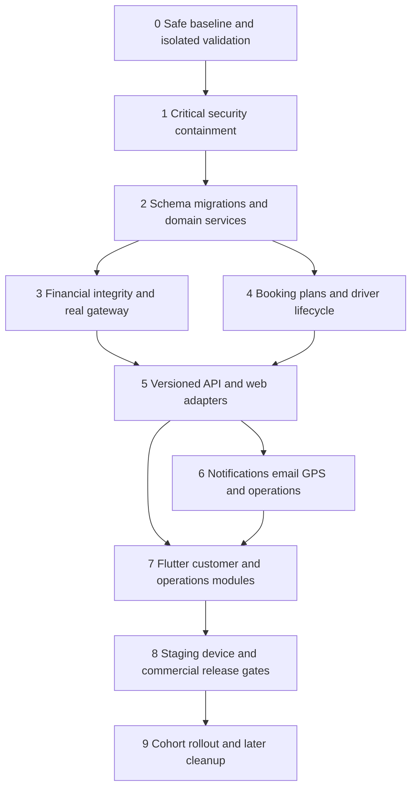

# CLEVO incremental migration plan

Plan date: 2026-11-15. Status: documentation only; no phase below has been implemented. The audit and four requested documents are this phase's deliverables. Preserve existing PHP/MySQL, all four roles, current working functionality, Arabic/English and dark/light mode throughout.

Subsequent phase results are recorded separately in [SECURITY_CHANGES.md](SECURITY_CHANGES.md) and [DATABASE_CHANGES.md](DATABASE_CHANGES.md); the plan below is the historical dependency roadmap.

Use [AUDIT_REPORT.md](AUDIT_REPORT.md) as the evidence register, [FEATURE_INVENTORY.md](FEATURE_INVENTORY.md) as the parity checklist and [TARGET_ARCHITECTURE.md](TARGET_ARCHITECTURE.md) as the design. Audit IDs in this plan refer to those documents. Implementation is ordered by dependencies and release risk, not by screen count.

## Dependency order

Contract drafts, risk-based test design and Flutter visual/localization prototypes may proceed early, but do not integrate real money, issue production app credentials or claim feature completion before dependent backend gates pass. Implement one domain slice through service -> web adapter -> API -> tests -> mobile, rather than creating a second disconnected mobile backend.

## Phase 0 — Safe baseline and reproducible verification

**Depends on:** this documentation. **Outcome:** an isolated environment where current behaviors and repairs can be verified without changing real customer data.

1. Record source revision and inventory; capture current web navigation/screens in both languages/themes and all role journeys. Select working behaviors to preserve using actual execution, not filenames. The audit's 67 PHP lint passes are only syntax evidence.
2. Confirm the actual database server/version, schema, SQL mode, timezone and permissions; the audit's read-only connection failed with error 2002. Obtain a protected backup through the normal operational process and prove restoration into an isolated instance. Do not run the destructive `clevo.sql` on an existing database.
3. Create sanitized synthetic/anonymized fixture data for every service mode, role, payment method, plan and lifecycle. Keep credentials/private files out of fixtures and logs. Correct the six cross-owner driver assignments in the supplied demo relationships before using them as test truth.
4. Establish a supported patched PHP runtime and declared extensions, reproducible Composer install from lock, code checks and a minimal test harness in CI. Record that local CLI was PHP 8.2.12; do not confuse it with production SAPI. Pin/test the actual target MySQL release rather than assuming MariaDB behavior is portable.
5. Add high-value failing regression scenarios for reset authorization, role injection, payment proof/booking tampering and unauthenticated review writes. Define failure-injection and two-connection concurrency tests for financial changes. Tests added during implementation must assert business outcomes, not merely mirror functions.

**Exit evidence:** restored isolated data; role/mode journey baseline; schema/engine report; CI syntax/dependency checks; reproducible critical regression failures; protected secret-handling process. This phase does not establish production readiness.

**Reuse:** SQL entity/PK structure, existing pages, Composer lock, existing bilingual media/copy. Use the dump only as a reviewed fixture source, never as an upgrade script.

## Phase 1 — Critical containment and authentication repairs

**Depends on:** Phase 0. **Audit priorities:** A01-A11, F01/F02, B01, P03/P07, S03. **Outcome:** exposed critical paths are repaired while legitimate journeys remain available.

1. Repair password recovery so an unverified request session cannot reset any account. Introduce a verified, single-use, expiring grant and shared password policy; throttle requests/attempts, make responses non-enumerating, revoke sessions after successful reset. Test request-without-verify and replay first.
2. Restrict public registration to customer/owner applications and require allowed account status for every role, including administrator/driver. Review existing account roles for unauthorized privileged registrations in a protected audit; reports contain counts/IDs only, not passwords/tokens. Keep owner approval separate from email verification.
3. Rotate JWT/mail credentials and seeded/shared privileged credentials using the operational secret process; external rotation is a later implementation/deployment action, not something done by this audit. Replace fixed driver passwords with invitation/activation. Store keys/config outside source and web root. Plan invalidation so old exposed tokens cease working.
4. Repair legacy review reply authorization by delegating both reply entry points to one owner-scoped service. Preserve the valid owner UI and URL compatibility. Close unsafe file uploads using centralized validation/private document storage and nonexecution rules, retaining authorized access to legitimate existing media/documents.
5. Stop accepting client payment status at booking creation and stop trusting `mark_visa_paid`. Before real gateway support is ready, expose card/top-up as unavailable or sandbox-only with truthful UI. Keep verified wallet/cash/plan behavior available only after its integrity tests pass; do not present simulated payments as settled. This is a correctness exception to preserving misleading behavior, not a UI redesign.
6. Apply session/cookie and current-account authorization rules, CSRF coverage for all browser mutations, safe output encoding and trusted redirect/origin rules. Do not remove stateful web auth to make mobile auth simpler.

**Exit evidence:** critical security negative tests pass across every alternate PHP entry point; no public role injection; OTP bypass closed; uploaded executable content cannot be stored/served as executable; unauthenticated review writes denied; no deployed hardcoded/exposed credential remains active; simulated payment cannot issue funds/entitlements.

**Release rule:** no public commercial beta before this gate. Existing production containment, if any, must be separately planned and executed with actual environment access.

## Phase 2 — Controlled migrations and shared PHP services

**Depends on:** Phase 1. **Audit priorities:** P02/P04/P14, B04/B05/B06/B08/B09, F07/F08 and database findings. **Outcome:** one reusable PHP domain boundary over a stable, migratable schema.

1. Add a versioned migration runner and schema version table; derive additive migrations from the actual deployed schema, not just the dump. Run migrations with a separate privileged principal. Replace request-time `clevoEnsure*`, tracking enum ALTERs and save-location DDL with schema-version checks and a deployment gate. Verify web/API polling issues no DDL and works under DML-only runtime grants.
2. Run read-only integrity reports on wallet cardinality, balances, service/station/driver/subscription ownership, booking references, history cascades and purchased plan references. Resolve each inconsistency with provenance and reversible data mappings; preserve IDs and financial totals. No blind DELETE, merge or re-seeding.
3. Add archive/history-preserving behavior for stations/services/plans/users. Prevent cascades from destroying bookings/reviews/financial records. Define support retention before replacing five-minute physical deletion with closure/archive; preserve existing messages and legacy parsing.
4. Normalize role aliases, guest NULL ownership and support enum mapping. Add shared validators for strings, email/phone, prices, durations, coordinates, uploaded media and station scope; return controlled uniqueness conflicts. Separate recovery-address change from verified email identity.
5. Extract repositories/application services with small compatibility functions. Start with auth/catalog/support/reviews and existing wallet debit/calculation concepts. Add Composer autoloading without introducing a backend framework. Retain procedural controllers as adapters.
6. Add nullable new fields/tables and backfill in bounded batches: sessions/reset grants, booking version/deadlines/event history, typed payment/ledger references, term snapshots, outbox/devices/notification recipients and audit actors as needed by later phases. Document backfill provenance and exceptions.
7. Add constraints only after cleanup: wallet uniqueness, financial event IDs, booking reference uniqueness and appropriate domain bounds. Validate MySQL syntax/strict-mode and relational cycles, then add measured indexes.

**Exit evidence:** migration succeeds on both empty reviewed fixtures and a restored populated baseline; old web URLs work; runtime DB user cannot run DDL; rollback/forward-fix rehearsal passes; historical booking/financial counts and amounts reconcile; no features disappear due to cascade changes.

**Reuse:** existing IDs/tables, prepared mysqli patterns, shared CSRF/escaping/JSON concepts, booking item snapshots, bilingual columns, role dashboards and PHPMailer package. Harden implementations before moving them; extracting an unsafe helper does not fix it.

## Phase 3 — Financial integrity and real payments

**Depends on:** Phase 2; Phase 1 payment containment remains active. **Audit priorities:** F01-F10, A07, S01/S02. **Outcome:** money, points and entitlements have traceable, retry-safe business events.

1. Agree commercial policy before encoding it: JOD precision/rounding; commission basis; discount funding; points earning/redemption; eligible plan services/stations/modes/bundles; cash collection; cancellation windows; original-method refunds versus wallet credit; owner settlement milestone/reserves; subscription coverage and refund handling. These decisions are unresolved requirements, not silent assumptions.
2. Reconcile current balances/transactions and migrated opening positions. Add immutable balanced journal events with typed booking/payment/refund/withdrawal references and unique operation identities. Keep wallet balances/history as compatible projections updated in the same transaction. Record historical uncertainty instead of synthesizing provider captures.
3. Repair wallet/points/plan operations under consistent locks and idempotency records. Enforce nonnegative balances and consume/restore once. Booking payment state, ledger/points mutations and outbox events must commit together; failure at any intermediate step rolls everything local back.
4. Select a gateway after confirming merchant/Jordan/JOD suitability, refunds/3DS/mobile return/SDK or hosted checkout and webhook support. Add a narrow PHP adapter. Use its sandbox first; no raw PAN/CVV enters CLEVO persistence/logging. Create server-side intents with amount/currency/reference/quote snapshots.
5. Add raw-payload signature verification, event uniqueness, durable webhook receipt, state/amount/currency/merchant/reference checks, duplicate/out-of-order handling, late capture after timeout and processor reconciliation. Client redirects only trigger server status reads.
6. Implement actual top-up funding and plan purchase confirmation. Move owner settlement to the defined verified milestone; add pending/available/reserved funds and reversal obligations. Withdrawal review records processor/bank transfer evidence and administrator identity; rejection releases a reserve exactly once.
7. Repair KPIs/charts against documented financial definitions and real date windows. Separate gross booking value from captured/collected cash, earned commission, refunds, liabilities and net profit. Preserve UI placement, improve misleading labels only where needed.

**Exit evidence:** repeat/cross-device/concurrent commands produce one financial effect; injected DB/provider failures reconcile; no negative wallet/points; journals balance by currency; unpaid cancellations issue no funds; refunds reference original verified charges; one plan wash cannot be spent twice; owner withdrawals cannot exceed available reserves. Provider sandbox captures/refunds and webhook replay tests pass. Real-money production credentials remain a release-stage operation.

## Phase 4 — Booking, plans and driver lifecycle

**Depends on:** Phase 2 and financial event contracts from Phase 3; release requires Phase 3 completion. **Audit priorities:** B02/B03/B07/B09/B10, F08, S01/S02. **Outcome:** shared lifecycle rules work for station, home and delivery.

1. Centralize quote creation, service ownership/mode checks, station approval/availability, price/commission snapshots and plan coverage eligibility. Never accept a payment marker as evidence. Preserve multi-service bookings and current plan UI.
2. Implement station-local datetime/hours, duration/capacity/service-area validation for both creation and reschedule. Use explicit response/payment deadlines; ensure rescheduling policy does not retain an expired response window.
3. Make owner station scope explicit and consistent across services, drivers, station editing, orders, earnings and notifications. Resolve single-versus-multiple station product semantics without deleting data.
4. Define and enforce every legal status transition per mode. Merge owner/driver alternate completion paths through a single atomic transition/event service. Reject stale expected versions and terminal revival. Payment readiness must be enforced at dispatch/start, not only at completion.
5. Verify driver role, account state, assignment ownership/station eligibility and availability/conflicts. Preserve driver task access through scoped short-lived exchange grants; remove reliance on one permanent session-selected task as the only API identity.
6. Run deadline/subscription expiry in idempotent scheduled workers independent of page reads. Timeout/cancellation/rejection coordinates payment release/refund, plan/points restoration, assignment closure and notification events exactly once.

**Exit evidence:** all role/service-mode/payment combinations pass; concurrent accept/reject/cancel/complete cannot duplicate reward/payout; no terminal state reopens; fixture ownership mismatches are rejected; rescheduling/deadlines, last plan wash and offline/retry cases are covered.

## Phase 5 — Versioned REST API and legacy adapters

**Depends on:** Phase 3 and Phase 4 for mutation release; validated read-only catalog work can begin after Phase 2. **Audit priorities:** P01/P06/P12 and authorization/DTO gaps. **Outcome:** every existing feature has a documented, tested JSON contract.

1. Publish OpenAPI for `/api/v1` using the feature inventory. Define DTOs, machine enums, localization keys, money/time precision, method/status/error rules, cursor pagination, upload bounds and idempotency. Define which fields each role may see.
2. Add request middleware: strict JSON/content type, limits, correlation ID, bearer validation/current account, object authorization, throttles, explicit 405/OPTIONS and restricted web CORS. Configure actual Authorization forwarding.
3. Deliver endpoints in dependency order: auth/me/recovery -> catalog/profile/location -> quotes/bookings/history/status -> verified payments/wallet/plans/loyalty -> owner stations/services/drivers/orders/earnings -> driver tasks/status/location -> support/reviews/notifications -> admin reporting/moderation.
4. Refactor existing PHP page/AJAX handlers to call the same application services while preserving forms, redirects, CSRF, navigation and legacy JSON envelopes. Maintain `/api/index.php` compatibility; do not silently change old statuses/field names.
5. Add contract/authorization tests covering every role and object boundary, invalid bearer with a valid cookie, account revocation, unknown/unsupported routes, malformed/big payloads and paginated ordering. Verify responses contain no secrets, other owners' data, private docs or task login codes.

**Exit evidence:** inventory rows have implemented/explicitly unavailable endpoint status; OpenAPI tests pass; existing web-role journeys pass in both languages/themes; one set of business rules produces matching web/API outcomes. No Flutter screen needs to parse HTML or connect directly to MySQL.

## Phase 6 — Reliable integrations and operations

**Depends on:** Phase 5 identity/API contracts and Phase 2 outbox schema; may be implemented by domain slice. **Outcome:** notifications, mail and tracking survive retries, app suspension and provider failures.

1. Connect outbox/jobs to PHP CLI workers with lease/claiming, bounded retry/backoff, dead-letter visibility and event idempotency. Configure protected scheduling/supervision; prohibit web invocation of worker scripts.
2. Centralize email configuration/templates/trusted URLs; use queued verification/reset/approval/support delivery with resend and failure status. Verify provider delivery and domain authentication in staging; do not use live customer mail for tests.
3. Add per-recipient notification reads, authenticated device registration/token refresh/logout removal, HTTP v1 FCM delivery and protected credentials. Configure separate Android/iOS/Firebase environments and APNs capabilities. Push carries entity references/localized preview only; apps re-fetch authorized state.
4. Add task-scoped location samples with range/accuracy/timestamp/sequence checks, stale/null responses, stop-on-completion/revocation and bounded retention. Introduce maps/geocoding/routing adapters with quotas/cache/attribution/timeouts. Replace fake driver fallback with an explicit unavailable/stale state.
5. Preserve Lamea/weather/translation features while isolating chat sessions server-side and defining allowed data/provider contracts. Prefer stored bilingual catalog fields over live personal-name translation. Treat voice as a separately tested native permission feature.
6. Add redacted structured logs, metrics/error monitoring and alerts for failed payment/refund reconciliation, queue lag, deadline lag, stale locations, auth abuse, delivery failures and pending disbursements. Log request/operation/event identifiers rather than secrets or exact location payloads.

**Exit evidence:** worker crash/retry has one effect; two-admin reads stay independent; FCM token rotation and real-device push work; SMTP failure retries recover; background/stale GPS is truthful; quotas/privacy/access boundaries are tested; operational alerts reach a designated owner.

## Phase 7 — Flutter Android/iOS clients

**Depends on:** stable Phase 5 endpoints and Phase 6 integration contracts for relevant features. **Outcome:** native clients preserve the marketplace capabilities and role model.

1. Create the Flutter client in an additive directory/repository with shared API/domain/UI packages; do not relocate or replace PHP application files. Decide distribution of customer versus owner/driver apps at kickoff while retaining shared code. Admin stays supported on web; its functions are not discarded.
2. Implement localization, RTL/LTR, dark/light/system theme, typography/branding and accessible layouts from existing accepted behavior. Introduce secure auth storage, single-flight refresh, typed API models and consistent error handling.
3. Deliver customer slices: auth/verification/recovery -> catalog/search/location/profile -> quote/booking/status/history/reschedule/cancel/reviews -> verified payment return/wallet/loyalty/plans -> support/inbox/chat/weather as contracted.
4. Deliver owner slices: approval state/stations/hours/availability -> bilingual services/drivers -> incoming orders/assignment/completion -> reviews -> earnings/bank/withdrawals/inbox/support. Preserve explicit multi-station scope.
5. Deliver driver slices: invitation/code exchange -> own task list/detail -> navigation/GPS permissions -> authorized status progression/completion -> inbox/support. Make active tracking, stale data and permission changes visible.
6. Add universal/app links for email verification/reset/payment return; cold start/background resume must fetch server status. Safe read caching and retries are supported, but offline payments/bookings are not represented as confirmed. Use persisted idempotency keys after uncertain outcomes.

**Exit evidence:** role-specific feature parity matrix checked by actual use; Flutter tests and AR/EN theme screenshots; Android/iOS build/signing pipeline; physical-device push, location/background termination, permission denial, payment/3DS return and expired/revoked session tests pass. No private key/server credential is bundled in apps.

## Phase 8 — Staging and commercial release gates

**Depends on:** Phases 1-7. **Outcome:** a reviewable release candidate with evidence rather than assumptions.

| Gate | Required evidence |
|---|---|
| Security | Critical and high auth/financial issues resolved; all legacy alternate paths tested; role/object matrix; upload access/nonexecution; no active source credentials; current-account revocation and API throttles |
| Money | Provider sandbox capture/refund and replay evidence; idempotency/concurrency/failure injection; ledger reconciliation by currency; withdrawal reserve/process evidence; confirmed plan/points funding rules |
| Data | Restored backups, migration dry-run on populated anonymized data, history-preserving archives, FK/domain consistency and no unexplained wallet/ledger drift |
| Functional parity | Admin/Owner/User/Driver flows across all service/payment modes; support guest/customer fix; AR/EN, RTL/LTR, both themes; truthful unavailable features |
| Mobile/device | Signed Android/iOS staging builds; real-device push/background tracking/permission/deep-link/3DS/offline-resume tests; store-facing permission text consistent with actual behavior |
| Deployment | Pinned patched PHP/extensions and supported DB; private DB; HTTPS/trusted proxies; no public dump/VCS/config/private docs; runtime DML-only grants; protected workers; environment-separated credentials |
| Reliability | Representative-load measurements, bounded queries/pagination, deadlines independent of traffic, alerts/dead-letter ownership, provider outage behavior, defined RPO/RTO and successful restore drill |
| Rollback | Safe previous build, feature flags/cohort controls, backward-compatible schema, provider/ledger reconciliation playbook and a rule prohibiting rollback behind confirmed external payments |

A reviewed release candidate precedes any publish/deploy step. This plan does not authorize deployment, bank/payment account changes, messages to users, store submission or production data cleanup. Those are future explicit operational tasks.

## Phase 9 — Cohort rollout and deferred cleanup

**Depends on:** all Phase 8 gates. Start with internal roles and a limited customer/owner cohort. Monitor payment/ledger deltas, failed auth/recovery, transition conflicts, queue/deadline lag, stale GPS and support retention. Expand only after agreed observation windows and error budgets.

Keep the existing web application usable. Deprecate old API shapes only with usage evidence and an announced client compatibility window. Remove duplicate implementations/dead markup after parity and consumer checks; retain compatibility adapters as needed. Do not drop old columns/tables or rewrite financial history during initial mobile rollout. Consider additional infrastructure only after measured bottlenecks.

## Reuse and replacement decisions

| Existing component | Reuse decision | Required work before reuse |
|---|---|---|
| PHP/MySQL stack, entity IDs and marketplace model | Keep | Runtime pinning, migrations, data cleanup, authorization and constraints |
| Existing role pages, branding/media, bilingual content and themes | Keep current web UI | Regression baseline; adapters into shared services; fix only correctness/security gaps |
| CSRF/escaping/JSON helpers | Keep concepts and compatible wrappers | Cover all entry points; separate transport-specific session/bearer rules and contexts |
| Password hashing/session regeneration | Keep modern operations | Retire plaintext/SHA-256 fallbacks, fix role/status/reset grants and revocation |
| Handwritten JWT implementation/shared key | Replace security implementation within PHP | Maintained library, strict claims, rotated protected keys and revocable sessions |
| Prepared mysqli queries/object scoping | Keep where correct | Central repositories, strict validation, transaction boundaries and query plans |
| Wallet conditional debit | Keep atomic sufficient-balance approach | Surround ledger/status/idempotency transaction and enforce wallet ownership uniqueness |
| Wallet history/payout/points business concepts | Keep feature semantics after policy review | Typed immutable events, exact money, reserves, concurrency safety and reconciliation |
| Simulated card confirmation/top-up | Replace unsafe internals; preserve intended payment UI purpose | Real provider intent/capture/webhook/refund implementation and truthful status |
| Booking item snapshots/cancellation/reschedule helpers | Reuse concepts | One lifecycle/deadline service, correct refund/restore exactly once, capacity checks |
| Plan expiry/consume/restore helpers | Reuse concepts | Purchased terms/eligibility, idempotent events, schedule independent of page traffic |
| PHPMailer and email templates | Keep package/template content after review | Central secrets, queue/retry/resend, trusted app links, localized escaping and delivery tests |
| Database notifications | Keep inbox/history concepts | Per-recipient reads, outbox and FCM/APNs delivery/devices; remove secret previews |
| Leaflet/maps/GPS and existing route UX | Keep web map experience | Provider contracts, stale/accuracy data, authenticated API and native background tests |
| Support tickets/messages/review features | Keep | Guest/role fixes, ownership on every entry point, retention/archive and shared reply logic |
| Runtime schema repair/destructive bootstrap dump | Do not use as deployment migration | Versioned migrations and separate reviewed fixtures |

## Decisions to settle during implementation

These do not block completing this audit, and no confirmation is required in this documentation phase: gateway and merchant settlement support; exact JOD/points/commission rules; plan entitlement/funding economics; single/multiple station scope; cash collection and refund/cancellation rules; task-code scope/driver availability; location/support retention; mobile app distribution; production hosting/DB version; provider budgets and recovery objectives. Convert each to a recorded decision before implementing its dependent slice, with safe assumptions explicit in tests/contracts.

**Stop boundary:** the requested audit/design/documentation phase ends with these four files. No application-code fixes, migration execution, provider integration or Flutter implementation has been performed.
