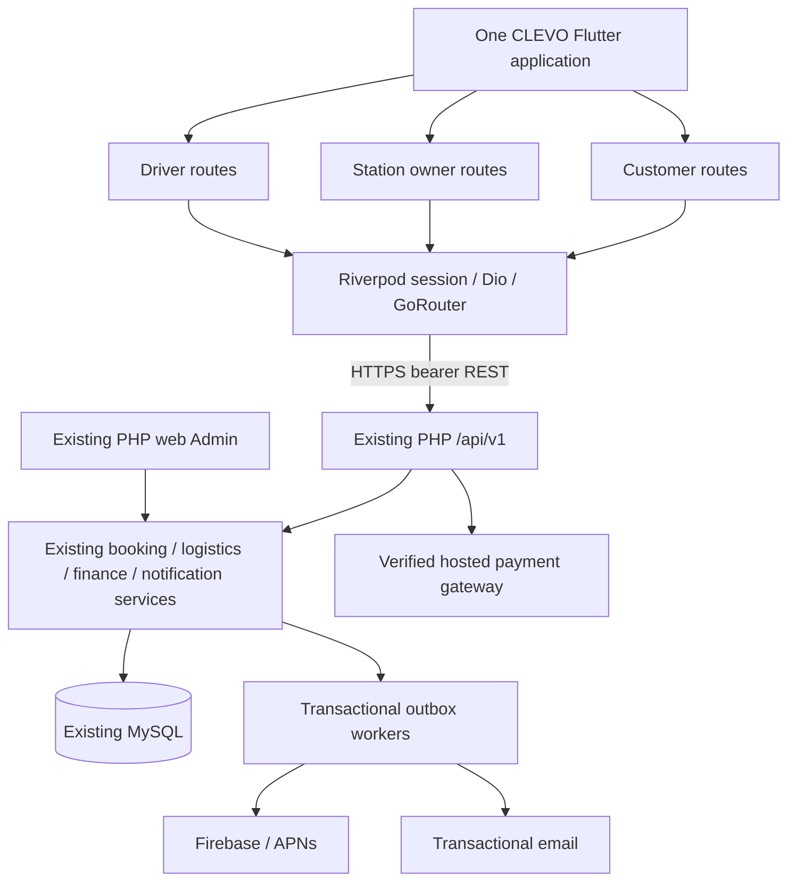

# CLEVO unified mobile application

The single project is `mobile/clevo`, with one Android package and one iOS target (`com.clevo.clevo`). Customer, station owner, and driver experiences share the same executable, session, HTTP client, design system, and PHP/MySQL source of truth. The existing PHP Admin dashboard remains the administrative application.

## Implementation boundaries

- `lib/core/api.dart`: fixed-origin Dio clients, structured failures, encrypted platform token vault, single-flight refresh, serialized secure writes, generation fencing against logout races. Mutations retain the original idempotency key on authentication retry. No certificate bypass, interceptor token logging, automatic mutation network retry, or embedded backend credentials.
- `lib/core/state.dart`: Riverpod session loads `GET me` after login/restoration. A trusted server role selects navigation; JWT payloads and local selections do not grant roles. Display preferences alone use SharedPreferences.
- `lib/app.dart`, `core/navigation.dart`: GoRouter guards; Admin is directed to the web-management explanation. Resource ownership is still checked by every PHP endpoint. Arbitrary notification URLs are never opened.
- `lib/features/`: real API-backed forms, paginated lists, distinct role dashboards, booking and payment details, owner service/availability management, assigned driver jobs, private handoff codes, account/support/history/preferences.
- `core/notifications.dart`: explicit device permission and session-bound token registration, rotation listener, revocation on sign-out. Firebase setup is opt-in. The existing backend uses FCM HTTP v1 registration tokens; the FlutterFire legacy token API is retained deliberately while that transport remains the backend contract. FID direct-send requires a coordinated backend migration.
- `features/tracking.dart`: ten-second authorized projections, user-enabled foreground samples only, bounded one-point memory retry preserving timestamp/assignment/sequence, no GPS disk cache. Leaving the screen, backgrounding, logout, assignment changes or terminal authorization ends collection. Maps show fresh authorized driver positions only.
- `features/payments.dart`: backend price authority, separate cash workflow, provider-hosted external browser checkout with a strict Jordan PayTabs HTTPS allowlist, verified server status. Redirects do not establish payment success. No PAN/CVV, wallet credit fabrication or local subscription activation.

Arabic and English are supported through localized application labels and Flutter/Material localization delegates. Arabic selects RTL. Light/dark/system themes share CLEVO's existing cyan branding and original logo. Forms/lists constrain maximum width and scroll on compact devices. Database text is rendered as plain Flutter Text, not HTML.

## Configuration and release gates

Copy `mobile/clevo/config/example.json` to ignored `config/local.json` and set the actual HTTPS API URL. Build with `--dart-define-from-file=config/local.json`. The default `.invalid` host deliberately cannot act as a production backend. Public mobile configuration is compiled into the app; never put SMTP credentials, JWT secrets, Firebase service-account keys, or gateway server keys in it.

Maps and Firebase default to disabled. Supply the approved package/bundle registrations and restricted platform keys before enabling their Dart flags. Android uses the environment value `CLEVO_ANDROID_MAPS_KEY`; iOS reads ignored `Flutter/Secrets.xcconfig`. Actual Firebase native configuration files remain ignored. Configure the existing PHP Firebase project/service account separately as documented in `NOTIFICATIONS.md`. No real messages are sent by development tests.

Android targets SDK 36, minimum 24. iOS minimum is 15.0. No background location permission, service or `UIBackgroundModes=location` is added. Background tracking remains explicitly rejected by PHP. If later required, obtain product approval and a separate platform/privacy review before changing either end.

Current account records contain a single scalar role. Multiple authorized roles and server-controlled switching are **not implemented in the PHP schema/API**. The app therefore exposes exactly the role returned by `GET me`; it does not invent a role-switcher. A future migration needs role membership, explicit role context in access tokens, refresh-session handling and backend object-authorization tests before presenting multiple choices.

Production online checkout, stored-value wallet spending/top-up, paid plan activation and settlements remain gated by existing provider/legal configuration and approvals. The app reports server unavailability and preserves pending/unknown states. Catalog plan names are read from MySQL; no Silver/Gold/Diamond aliases or synthetic plans are introduced.

## Reused backend components and remaining API gaps

No PHP business service is duplicated in Dart. Prices, discounts, capacity, booking transitions, commission, refunds, driver permissions, OTP validity, location visibility, notification routing and subscription eligibility remain in the existing PHP services and migrations. No database migration is required for this mobile client phase.

The current REST API does not expose owner station creation/onboarding or owner-specific subscription administration. Existing web functionality remains available; the app identifies station onboarding as a web action. The API's owner financial statement is authoritative; payout execution remains commercially disabled. Driver account provisioning/invitations remain owner-managed. The current mobile registration UI supports customer registration; owner document onboarding stays with the existing verified web flow.

See `MOBILE_API_MATRIX.md` for feature-to-screen-to-endpoint mapping and `MOBILE_TEST_REPORT.md` for actual verification and outstanding device/release gates.

## Changed files

New application: `mobile/clevo/pubspec.yaml`, lockfile, analysis rules, `lib/main.dart`, `lib/app.dart`, `lib/core/*`, `lib/ui/common.dart`, `lib/features/*`, `assets/brand/logo.png`, `android/*`, `ios/*`, configuration examples, tests and README. Native project files are Flutter-generated with deliberate permission/configuration/signing changes. Build/SDK caches, native private configuration and signing material are ignored.

Root changes: `.gitignore` excludes local SDK tooling; `.htaccess` denies web access to mobile sources and SDK caches. `tests/mobile-fixtures.php` and the optional `-Flutter` argument in `tests/run-isolated.ps1` add disposable live integration verification. Source scanners skip SDK/build caches, Apache rules test mobile-source protection, and the legacy registration test reads the CSRF challenge from the registration form itself. Existing application PHP pages, business services and MySQL schema are preserved.
