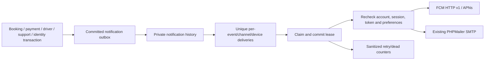

# CLEVO notifications and transactional email

Phase date: 2026-11-16, Asia/Amman. PHP/MySQL and the existing inbox, verification/recovery email infrastructure, Arabic/English and PHP dashboards remain. No external message has been sent during development. Firebase/APNs credentials, sender-domain approval and hardware delivery are not established by local tests.

## Audit and implementation

The existing `notification_outbox` correctly coupled committed business events to one inbox insert, but had no external delivery queue, mobile token registration, notification preferences or FCM adapter. Notifications created outside a domain transaction previously bypassed the outbox. The existing SMTP worker held a database transaction open during SMTP, and the development null transport marked queued mail sent. Those behaviors are superseded here.

`includes/notifications.php` provides protected device registration, preferences, private template rendering, a PHP HTTP v1 FCM adapter and a leased delivery worker. `includes/booking-notifications.php` retains the established transactional outbox and schedules external delivery in the same transaction as inbox insertion. Both notification helper functions in `app-helpers.php` now use this path. No application request sends FCM or SMTP directly.



Migration `008_notifications.sql` adds `mobile_devices`, `notification_preferences`, `notification_deliveries`, plus claim/lease/error fields on `security_mail_queue` and a forward-only tracking phase epoch. Existing migration `007_driver_tracking.sql` is unchanged. No historical business records are deleted or reset. All migrations were designed for rehearsal through the existing checksum/step-journal runner. Use [DATABASE_BACKUP_RESTORE.md](DATABASE_BACKUP_RESTORE.md), maintenance mode, an actual schema inventory and a disposable restore before deployment. Bootstrap fails closed if these migrations are missing.

## Event coverage and reuse

| Event | Authoritative source | Delivery behavior |
|---|---|---|
| Registration | `clevo_register()` in `security/auth.php` | Private welcome inbox plus queued verification email; no public token/PIN in push. |
| Email verification | `clevo_verify_email()` | Transactional inbox event; existing expiring, single-use email challenge remains. |
| New booking | `commerce.php` | Owner inbox plus individual channel jobs; booking identifier added to internal target. |
| Acceptance / rejection / cancellation | `booking-workflow.php` | Existing committed status notifications for authorized participants. |
| Driver assignment / arrival / delivery stages | `marketplace.php`, `logistics.php`, central booking transitions | Customer/owner/driver events through the same outbox. No driver login or handoff code in messages. |
| Service completion | Central completion and owner service confirmation | Existing effect guards and stage state prevent repeat transitions from issuing another event. |
| Payment confirmation | `finance/orders.php` | Only verified provider confirmation; sandbox is explicitly labelled. |
| Refund updates | `finance/refunds.php`, existing refund review | Request/review remains distinct from verified money returned. |
| Subscription activation | `finance/subscriptions.php` | Explicit sandbox activation notification after verified funding, in the activation transaction. |
| Support response | Existing support helpers/API | Existing scoped in-app response notification; guest replies retain encrypted email queue. |

Role broadcasts remain role-scoped **in-app only**. They are not expanded into an unbounded external mailing list. Each individual inbox row schedules at most one email and one push per currently registered device, using unique deduplication keys. Existing business transaction/idempotency/effect guards prevent repeated commands from duplicating their domain event. Independent events with identical text are not incorrectly collapsed forever.

Some existing business transitions intentionally notify several participants or create both a booking-status event and a logistics-stage event. These are distinct events. This phase does not promise content-based deduplication of separate business events.

## Device security and preferences

- Only authenticated persistent sessions may register devices. Assignment-only driver sessions cannot manage account-level device/preferences resources. A device token is a delivery address, not authentication authority.
- Tokens are encrypted using the existing AES-256-GCM protected APP_KEY helper; lookups use keyed hashes. Responses expose an opaque device identifier only. Tokens are absent from logs/history/monitoring. Preserve APP_KEY recovery references when rotating encryption keys.
- A token bound to another still-active session cannot be stolen through account switching. Rebinding after that session expires/revokes requires authenticated registration. Clients should revoke the device before logout/account switching and register `onTokenRefresh` values only after login.
- Delivery rechecks current account state, auth version, non-revoked session, device owner and token age. Revoked/expired sessions cannot receive new push. Stale devices expire after 30 days and their encrypted tokens are cleared by the worker. Refresh token registration regularly while signed in.
- Preferences select Arabic/English and independent push/email switches. Workers recheck preferences at send time, so an opt-out affects jobs already queued. In-app transactional history remains available. Verification and recovery emails are account-security operations and are not suppressed by business channel preferences.
- Only the owner's device identifier can be revoked through the device API. No endpoint enumerates another user's tokens or accepts a caller-supplied recipient user ID.

Do not replace APP_KEY blindly: it protects queued mail, device ciphertext and keyed token lookups as well as the earlier encrypted application records. Rehearse protected decrypt/re-encrypt and hash rebuilding before changing it, or revoke/clear device bindings and require client registration again while separately migrating the mail queue. Never export plaintext tokens into an operational report. Firebase service-account key rotation is separate: replace the protected file, restart bounded workers and revoke the old key through the actual Firebase/Google account after verification.

## API

Existing `GET /api/v1/notifications`, individual read and read-all APIs remain role/object scoped and paginated. History now adds `route: {screen, entity_id}`; raw legacy target URLs are not exposed as navigation authority.

| Method / path relative to `/api/v1` | Purpose |
|---|---|
| `POST /me/notification-devices` | `{token, platform: android|ios}` -> `{device_id}` |
| `POST /me/notification-devices/revoke` | `{device_id}` -> idempotent scoped revocation |
| `GET /me/notification-preferences` | Own `Language`, `PushEnabled`, `EmailEnabled` settings |
| `PUT /me/notification-preferences` | `{language: ar|en, push_enabled: boolean, email_enabled: boolean}` |
| `GET /admin/notification-deliveries` | Admin-only channel/state/error counts; no token or payload |

The generated [OpenAPI specification](openapi.v1.json) and [inventory](API_ENDPOINT_INVENTORY.md) now contain 159 operations across 138 paths, including the preceding logistics additions. JSON envelopes, JWT revocation checks, request limits and role gates remain shared with the existing API. These five new routes are additional to the existing notification history/read routes.

Example, placeholders only:

```http
POST /api/v1/me/notification-devices
Authorization: Bearer <access-token>
Content-Type: application/json

{"platform":"android","token":"<FCM registration token from this installation>"}
```

Do not use a Firebase service-account key, APNs key or CLEVO refresh token in this request. Token refresh replaces/re-registers the device address. Remove obsolete device bindings through revoke; do not print registration tokens during client debugging.

## FCM and iOS preparation

The PHP adapter signs a short-lived RS256 service-account assertion, requests an OAuth token at the fixed Google OAuth endpoint, and sends to the fixed `fcm.googleapis.com/v1/projects/.../messages:send` endpoint. It does not use the retired legacy server-key protocol, client-supplied URLs or service-account `token_uri` routing. TLS verification remains enabled; redirects are disabled and time/response-size limits apply. See [Firebase HTTP v1](https://firebase.google.com/docs/cloud-messaging/send/v1-api) and [trusted server environment](https://firebase.google.com/docs/cloud-messaging/server-environment).

Configuration defaults in `.env.example` are disabled/blank:

```dotenv
NOTIFICATION_EXTERNAL_SEND=0
FCM_ENABLED=0
FCM_SERVICE_ACCOUNT_FILE=
```

Production activation requires an actual approved Firebase project/service account with least-privilege messaging permissions, key material outside the document root/repository, HTTPS, working SMTP, verified sender domain and restrictive filesystem permissions. The adapter refuses development/testing external delivery; tests inject local closures. A deployment configured as production still needs explicit external-send and FCM enablement. No real credentials were provided or invented.

For iOS, register the correct bundle ID with Firebase, upload the real APNs authentication key to Firebase, configure signing/provisioning and Push Notifications capability, and request notification consent in context. Wait for an APNs token before FCM token API calls on Apple devices. Follow [FlutterFire setup](https://firebase.google.com/docs/cloud-messaging/flutter/get-started) for required method swizzling and platform initialization. The PHP APNs payload uses visible alert semantics, a bounded expiry and stable collapse identifier; it does not enable silent background execution or location access. APNs/Firebase console provisioning and physical-device delivery remain untested and blocked pending credentials.

Android clients must handle current notification permission and unavailable Play services; iOS clients must handle denied/provisional consent. Refusing notification permission must not block booking access. No location permission is required merely to receive a notification or view the driver's server-provided map position.

## Content, templates and deep links

Push lock-screen text is deliberately generic in the chosen language. Data carries only an event identifier, notification identifier and allowlisted screen/entity identifiers. It contains no booking totals, address, coordinates, customer phone, bank/card data, password, access/reset/refresh token, driver access code or handoff confirmation. Open the app and fetch the referenced resource with current authorization.

Business HTML email uses responsive presentation tables, a 600px maximum content width, CLEVO blue branding, escaped text and Arabic RTL/English LTR layouts. For a recognized booking link, customer/owner authorization is rechecked before including the actual booked service snapshots, date/time, additional fee and after-discount total from MySQL. Driver email does not acquire customer financial details. Totals are booking totals, not a claim of successful payment or a fiscal invoice. Security/support emails reuse PHPMailer and now receive the same branded responsive shell.

Verification links and recovery codes are delivered only through their intended private, encrypted account-security email queue. That necessary account-recovery delivery is distinct from push/in-app notifications; these secrets are never copied into push history, delivery logs or navigation data. Existing fragment-based expiring verification links remain unchanged.

Allowed screens include `booking`, `owner_booking`, `driver_job`, `subscriptions`, `support`, and `notifications`. Unrecognized or external target URLs fall back to the inbox. Client routing must validate identifiers, wait for authentication/navigation readiness, verify the user's current role, fetch the resource and handle 401/403/404. Never launch arbitrary URLs from push data. Handle foreground messages, `onMessageOpenedApp`, and `getInitialMessage`; deduplicate by event/notification identity in a bounded store. A notification does not authorize access or establish current booking/payment state.

## Workers, retries and monitoring

Schedule with protected configuration:

```text
php scripts/booking-notification-worker.php
php scripts/notification-delivery-worker.php
php scripts/security-mail-worker.php
```

The outbox-to-inbox transaction is atomic. External workers claim and commit a two-minute lease **before** networking, and acknowledge only their matching claim afterward. SMTP security jobs now use the same separation. Batches are bounded (50 by default; business delivery cap 200), failures back off exponentially, and jobs stop after five attempts. Expired leases are recoverable; exhausted leases are dead. No web endpoint triggers outbound delivery.

FCM `UNREGISTERED` revokes and clears the token; generic payload `INVALID_ARGUMENT` does not blindly invalidate every token. HTTP 429/503 respect bounded `Retry-After` and exponential delay. See [Firebase error codes](https://firebase.google.com/docs/cloud-messaging/error-codes) and [token management](https://firebase.google.com/docs/cloud-messaging/manage-tokens). Configuration failures are monitored and bounded rather than retried in a tight loop.

External delivery is **at least once**. If a provider accepts a message and the worker crashes before acknowledging, retry can produce another notification/email. Stable FCM event IDs/collapse tags and SMTP Message-ID reduce duplication, but SMTP/FCM do not provide an exactly-once recipient guarantee. `sent` means transport acceptance, not that a person read a message or that APNs displayed it. Development null transport no longer marks account-security messages delivered; encrypted queue rows are retained while external sending is disabled.

Business events older than 24 hours are skipped for external delivery while remaining in history. Account-security email payloads carry an expiry aligned with the verification/reset challenge; expired payloads and old queue entries without expiry metadata are cleared for review instead of sending stale codes. The disabled CLI preserves outbound jobs without consuming their attempt budget. Stable SMTP Message-ID uses the configured sender domain. Protect and monitor the separate security-mail queue as well as business delivery counters.

Use the admin aggregate API and protected DB queries to alert on oldest queued age, expired sending leases, increasing attempts, dead jobs, configuration failures and invalid-token rates. `LastError` contains controlled codes, not exception text, addresses, tokens, message bodies or credentials. No message body is printed by either worker. Protect provider-level logs and exported counts with the same access policy as application operations.

The per-table grant example includes new runtime tables and separate delivery/retention worker privileges. Avoid database-wide DELETE/DDL grants. Business delivery workers need read access to current account/session/preferences and authorized booking snapshots, SELECT/INSERT/UPDATE on delivery jobs and UPDATE on device revocation; they do not need financial or booking mutations. Existing sender-domain SPF/DKIM/DMARC, bounce handling, email-client rendering and provider quotas need deployment verification; they are not certified by local PHP tests.

## Validation and limits

`tests/notifications.php` exercises encrypted device storage and deduplication, rollback isolation, unique channel jobs, localized escaped HTML, scoped API registration/preferences/history/revocation, transport retries and opt-out, session revocation, allowlisted routing, disabled FCM, real OAuth signing with an ephemeral key and HTTP-v1 serialization through local closures. No external transport is contacted. Full security/API/booking/financial/logistics/database/Apache regression results are recorded in [NOTIFICATION_TEST_RESULTS.md](NOTIFICATION_TEST_RESULTS.md).

Real Firebase/APNs/SMTP delivery, Flutter hardware permissions/navigation, screen-reader/email-client visual QA and load/failure certification remain deployment gates. There is no full Flutter app in this repository; the preceding tracking request authorized an integration example in `docs/flutter/`. This phase does not build or publish a mobile app.
