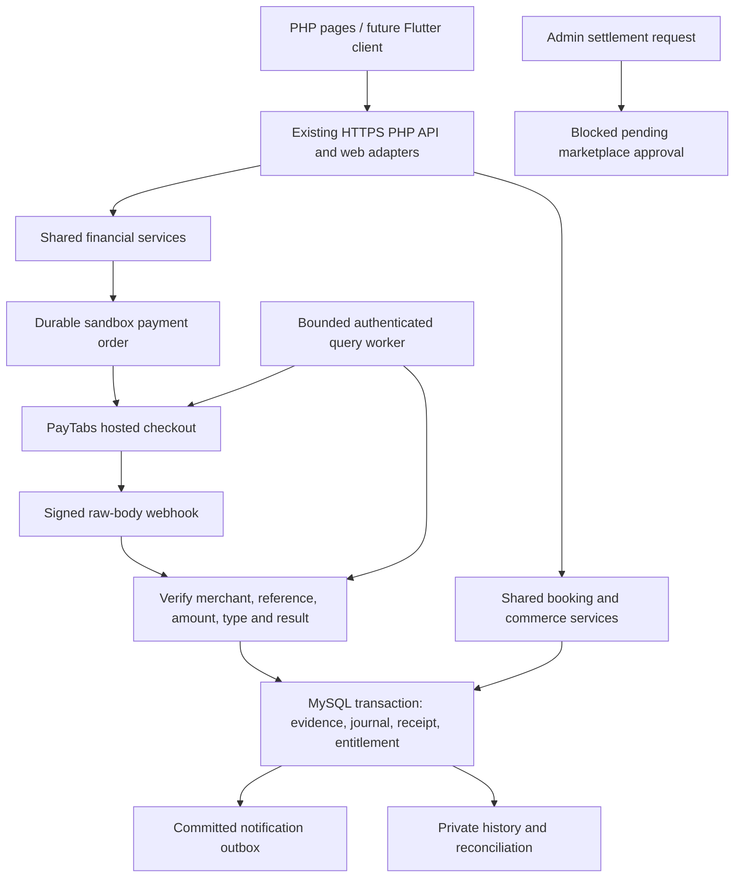

# CLEVO payment integration

Implemented payment phase, 2026-11-16. Read this with [PAYMENT_TEST_RESULTS.md](PAYMENT_TEST_RESULTS.md), the [OpenAPI specification](openapi.v1.json), [endpoint inventory](API_ENDPOINT_INVENTORY.md) and [shared booking workflow](BOOKING_WORKFLOW.md). PHP/mysqli, MySQL, existing roles, PHP dashboards, Arabic/English and themes are retained. No production database, provider account or bank transfer was used.

**Release status:** cash collection has a separate accountable workflow. Online payment and paid subscriptions have a fail-closed sandbox implementation. Production online processing, commercial stored value and owner payouts remain blocked. Supplying credentials or changing an environment flag cannot enable live processing in this release. Missing provider onboarding and commercial approvals are blockers, not successful integrations.

## Audit and changes

The original [audit](AUDIT_REPORT.md) is a historical baseline. Source review for this phase confirmed the following remaining issues after the intervening security/API/booking work. References below identify the current guards or replacements, rather than claiming that historical line numbers still apply.

| Severity / evidence | Finding at phase entry | Implemented behavior / current evidence |
|---|---|---|
| HIGH / confirmed | The compatibility card operation already returned 503, but the PHP checkout still displayed a local card form and retained a client success flow without a processor. | `includes/payment-gateway.php:21` keeps the old action unavailable; `:27` starts a backend order; `:240` navigates only to the returned hosted URL. Local PAN/CVV collection was removed. |
| CRITICAL / confirmed | `clevoCreateUserPlanSubscription()` could activate an entitlement without a verified funding record. A `subscribed` query parameter could display a success message independently of payment. | `includes/plan-helpers.php` gates legacy activation; `includes/finance/subscriptions.php:50` requires a verified funding order. `user/customer-plans.php` no longer treats the query string as confirmation. |
| HIGH / confirmed | Legacy wallet balances had no verified funding source; payment/refund/withdrawal helpers could treat these balances as commercial value. | `includes/finance/ledger.php:31` restricts legacy mutations to the dedicated synthetic test database. Production spending, top-up, old subscription purchase and withdrawals return unavailable. Historical rows and read access remain. The direct loyalty-to-wallet page and legacy wallet mutation helpers are also gated; conversion uses the same idempotent fixture ledger when explicitly exercised in isolated tests. |
| HIGH / confirmed | New bookings still calculated 10% of gross; commission and wallet arithmetic used two decimal places. Owner credits could precede fulfillment. | New versioned snapshots and integer-fils calculations in `includes/finance/ledger.php:20`, recognition after fulfillment in `recognition.php:10`; historical commissions are unchanged. |
| HIGH / confirmed | A package wash could release the nominal service price to the owner without allocating the package's actual purchase funding. Marketing text did not enforce eligibility. | Explicit sandbox policy, immutable purchase terms and funded redemption slots in `subscriptions.php`; recognition conserves collected package value. |
| HIGH / confirmed | No provider-backed session, signed confirmation, refund reversal or bank reconciliation existed. Old session/refund tables represented requests, not proof. | `orders.php`, `provider.php`, `refunds.php`, append-only financial records and `reconciliation.php`. New sandbox order/refund records are distinct from legacy records. Bank reconciliation remains explicitly false. |
| HIGH / untested externally | Jordan merchant approval, marketplace acquiring, actual callback/query/refund shapes and bank settlement have not been certified for CLEVO. | Live activation is blocked. Tests use a local transport seam and signed fixtures; real provider sandbox certification is still required. |

Working login, booking status, cancellation, cash selection, service management and historical reporting are retained. Unfunded financial issuance is intentionally unavailable outside isolated tests. Existing historical payment/subscription records are preserved and flagged for reconciliation; this phase does not invent evidence or opening balances for them.

## Provider selection and commercial boundaries

**PayTabs Jordan is the conditional integration candidate**, using the Jordan API origin `https://secure-jordan.paytabs.com`. Its [hosted checkout documentation](https://docs.paytabs.com/manuals/PT-API-Endpoints/Integration-Types-Manuals/Hosted-Payment-Page/HPP-Step-3-Initiating-Payment/HPP-Initiating-Payment/) describes the backend request/redirect flow. This is a technical selection, not approval of CLEVO as a merchant.

PayTabs documents split payouts as a **PSP-through-bank facility**, with bank-controlled onboarding/configuration; ordinary ecommerce credentials do not establish marketplace payout permission. CLEVO must obtain written agreement for its merchant-of-record/agency arrangement, station onboarding, submerchant KYC, commissions, refunds, disputes, reserves and settlement. See [PayTabs split-payout prerequisites](https://docs.paytabs.com/manuals/PT-API-Endpoints/Deposit-and-Payouts/Split-Payouts/Step-1-Understanding-Workflow-and-Prerequisites/Split-Payouts-Prerequisites/). No split-transfer API or automatic owner payout is enabled here.

Required before real money: actual approved Jordan test profile and credentials; verified merchant/profile identifiers; HTTPS callback deployment; successful provider sandbox certification; bank/acquirer marketplace contract; approved owner/subscription terms; tax/invoicing treatment; fee/refund/dispute handling; and operational sign-off after restored-copy MySQL and bank reconciliation testing. No credentials were provided, invented, committed or printed. Provider charges, onboarding eligibility, settlement timing and fee schedules are account-dependent and are not assumed.

The [CBJ payment-system legislation index](https://cbj.gov.jo/EN/List/Payment_Systems_Legislations) and [bylaws](https://www.cbj.gov.jo/EN/List/Bylaws) are the starting point for qualified Jordan legal/bank review. Review custody of customer money, redeemability, wallet licensing, safeguarding, AML/KYC, chargebacks and refund destination for CLEVO's actual model. This implementation is not a determination that CLEVO may issue stored value. Published regulatory lists alone do not establish that permission.

## Architecture and reuse



`includes/finance.php` loads provider, ledger, orders, subscriptions, recognition, refunds and reconciliation services. The provider interface supports create/query/refund/signature verification; its runtime factory exposes only the guarded PayTabs sandbox adapter. Provider calls use verified TLS, fixed Jordan origin, bounded response size/timeouts and no redirects or automatic POST retries. The optional transport closure is injected by CLI tests; there is no HTTP-selectable fake provider or production success override.

The existing `commerce.php`, `booking-helpers.php`, `booking-workflow.php`, `marketplace.php`, plan helpers, authentication, CSRF, rate limits, parameterized queries, idempotency storage, audit logs and notification outbox are reused. PHP and API adapters call these same services. Notifications are enqueued in the business transaction and delivered after commit through the existing outbox machinery.

## Money and the approved commission basis

The user approved, on 2026-11-16, **5% for new bookings on services plus additional service fees after discounts, half-up to the nearest fils, leaving historical commissions unchanged**. Taxes and provider fees remain outside this calculation pending approved treatment. Jordanian dinar uses three minor-unit digits; this was verified against the official [SIX ISO 4217 currency list](https://www.six-group.com/dam/download/financial-information/data-center/iso-currrency/lists/list-one.xml), entry `JOD`, minor unit `3`.

New exact monetary values are integer fils, with canonical decimal strings for display. No submitted client price establishes a payment amount. `commission = floor((basis_fils * 500 + 5000) / 10000)` and `owner = basis - commission`. A 1.250 JOD basis produces 0.063 JOD commission and 1.187 JOD owner allocation. For a discounted 16.750 JOD basis, commission is 0.838 JOD. Refunds reverse the original allocations; they do not recalculate at a later rate.

Only newly created bookings receive `FinancialVersion=1`, rate 500 basis points and exact `CommissionBasisMinor`, `CommissionMinor`, `OwnerAmountMinor`. The original `Admin_Commission` remains a rounded two-decimal compatibility projection for existing pages. **Use the exact fields/journals for accounting.** Existing bookings retain their stored commission and NULL financial version; migration does not restate history. The legacy two-decimal service catalog and original payment amounts remain compatible; new exact financial records do not truncate commission fils into that catalog format.

For a funded subscription, the commission basis is the actual purchase-price allocation released for that booking, not an unlimited nominal service value. This prevents package-funded owner earnings exceeding collected funding. This sandbox allocation model still needs explicit owner/package commercial agreement before live launch. Existing promotional points are not assumed to be funded cash; their monetary use is blocked with the wallet outside isolated fixtures.

## Cash workflow

1. Customer selects cash on an eligible accepted booking. This does not confirm online payment, transfer money or earn commission.
2. The authorized station owner completes the service using the shared booking transition. Completion is the owner's physical collection attestation; it records `owner_cash_attestation` and an immutable receipt.
3. The ledger debits `cash_commission_due:<owner>` and credits platform commission. Gross and owner remainder are recorded as allocation metadata. Money already collected by the owner is **not** also credited as a payable to that owner.
4. Cash commission receivables are reported separately. Bank collection/settlement of these receivables is not implemented or represented as verified. Pre-service cancellation has no collected cash to refund. Post-service cash disputes/refunds need an approved operational process; no online refund or wallet credit is fabricated.

## Online state, proof and retry rules

| Order state | Meaning / next action |
|---|---|
| `prepared` | Valid server amount and target persisted; no provider attempt claimed. |
| `creating` | One durable create claim; database transaction is committed before the network request. |
| `pending` | Hosted session or provider pending/hold evidence; no paid booking or active subscription. |
| `unknown` | Ambiguous creation/network/response outcome. Query existing reference/cart; never automatically create another charge. |
| `failed` / `cancelled` | Verified negative provider result, or local cancellation before any create claim. Same-key retries retain the original attempt. A fresh attempt requires a fresh key after a confirmed terminal outcome. |
| `succeeded` | Verified matching sale and still-eligible booking/subscription; immutable capture and receipt exist. |
| `refund_due` | Verified money arrived after expiry, local cancellation, booking cancellation or lost eligibility. Record unapplied liability; never revive a booking or activate an ineligible plan. |
| `refunded` | Verified full refund has a compensating journal and receipt. |

The request key persists a minimal order identifier; a unique active intent prevents two keys creating simultaneous attempts for the same target. Account/booking/plan locks serialize eligibility. An open online attempt blocks cash/wallet payment races. Network calls occur outside database transactions, after a durable claim. A lost response or crashed `creating` order is reconciled by authenticated query, not a second POST. Cart queries yielding multiple transactions are sent for review rather than selecting one arbitrarily.

Local cancellation after submission hides the checkout URL and records cancellation intent. It **does not** claim the provider cancelled a charge. If money subsequently arrives, the result is `refund_due`. Browser return parameters never confirm anything: `/api/v1/return.php` is a static HTML acknowledgement without token, session or database processing.

### Webhook verification

`POST /api/v1/webhooks/paytabs` accepts JSON up to 64 KiB with the provider's `Signature` header. It verifies HMAC-SHA256 over the **unaltered raw body**, compares in constant time, then parses the payload. This follows [PayTabs callback signature guidance](https://support.paytabs.com/en/support/solutions/articles/60000718961). The browser return uses a different signing format and is deliberately not used as evidence.

The adapter requires matching configured merchant/profile, local cart/order ID, sandbox reference, JOD currency, exact amount and supported transaction type. A successful `A` must be a **Sale** with matching transaction total; an `Auth` success does not count as collected money. Holds/pending results do not activate anything. Declines/errors, cancellation/expiry and refund results are handled separately. See [PayTabs response status guidance](https://support.paytabs.com/en/support/solutions/articles/60000711358-what-is-response-code-vs-the-response-status-) and [transaction type documentation](https://docs.paytabs.com/manuals/PT-API-Endpoints/Integration-Types-Manuals/Request-Response-Parameters/Request-Response-transaction-type/).

An error response may omit transaction type; inference is allowed only for a non-success result bound to an already-known original/refund reference. A refund must identify the original sale through `previous_tran_ref`. Unsupported partial amounts, advanced authorization/capture flows or mismatched references fail closed for review. A refund delivered before capture evidence returns a retriable conflict without inserting money; after the sale is verified, the refund retry can apply.

Each evidence body/query has a digest, and each money operation has a unique semantic key. Exact, differently serialized, concurrent and reordered callbacks cannot duplicate capture, activation or refund. Late failure cannot downgrade verified money. Only sanitized identifiers/result/amount and digests are persisted; no raw provider payload, card details or signing material is logged. A provider signature is not assumed to include a timestamp: verified historical replays are made harmless by durable deduplication and state checks, not an invented replay window.

## Ledger, receipts and reconciliation

Migration 006 adds append-only journal headers, balanced signed entries, evidence and receipts. Each journal has a unique operation key and canonical content hash. Reusing the key with changed entries fails. Corrections append compensating entries; runtime credentials have SELECT/INSERT only on the four immutable tables. Privileged database administrators can still alter data, so protected backups and access auditing remain necessary. There is no claim of an externally notarized or tamper-proof ledger.

Books are `cash`, `sandbox`, and `legacy_fixture`; reports separate them. Synthetic legacy fixture postings are never commercial opening balances.

| Event | Debit | Credit |
|---|---|---|
| Eligible online capture | `provider_clearing` | booking or subscription deferred liability |
| Ineligible/late capture | `provider_clearing` | unapplied capture liability |
| Completed online service | deferred liability | owner payable plus platform commission |
| Owner cash collection | cash commission receivable | platform commission |
| Verified online full refund | remaining deferred liability and reversals of recognized owner/commission allocations | `provider_clearing` |

Capture is not fulfillment or bank settlement. Owner earnings become payable at completion. Receipts are private, immutable and evidence-labelled. They are **payment records, not Jordanian tax invoices**; invoice/fiscal integration is an explicit remaining approval and implementation requirement. Original payment history remains accessible, with unproven legacy rows surfaced by reconciliation.

`GET /admin/payment-reconciliation` and `php scripts/reconcile-payments.php` compare journal headers with lines, verify booking receipt/order agreement, count unproven legacy payments, ambiguous outcomes, late captures and multiple provider refund references, and show balances by book. `external_bank_settlement_reconciled=false` is intentional. No provider statement or bank file has been supplied, so external reconciliation and net settlement after fees/disputes are not claimed.

The CLI is read-only by default. `--query-provider` performs bounded authenticated queries (up to 10 orders and 5 known refunds per invocation). Shared query budgets are 45 reference queries and 15 cart queries per minute, below the documented provider ceilings; see [PayTabs query documentation](https://docs.paytabs.com/manuals/PT-API-Endpoints/Integration-Types-Manuals/Hosted-Payment-Page/HPP-Step-7-Manage-Transactions/HPP-Step-7-Query-Transaction/). An unknown refund reference can be selected with `--query-provider --refund-id=<internal-id> --provider-ref=<actual-sandbox-reference>`; the selector is not evidence, and all response matching still applies. Do not retry refund submission after an ambiguous outcome.

Administrator settlement requests are validated against owner payable, serialized and recorded as **blocked**, with `funds_transferred=false`. There is no API to mark them paid/verified and runtime grants do not permit settlement UPDATE. An approved bank/PSP adapter, actual settlement evidence, reconciliation and compensating dispute rules are needed in a future phase. A blocked request does not reserve or move funds.

The owner's transaction history is scoped by that owner's actual account entries, including compensating package refunds whose journal has several owners. `OwnerPayableDeltaMinor` is positive for earned payable and negative for reversal; `CashCommissionDueDeltaMinor` records the owner's cash commission obligation separately. Another owner's entries are never returned. Existing dashboard totals are labelled nominal/historical; use the exact statement and reconciliation endpoints for financial controls.

## Refunds and cancellations

A customer refund request records intent/reason only. An administrator may submit one full provider refund for a pre-service booking without driver acceptance, or an entirely unused paid subscription. Pending refunds block conflicting service execution; pending subscription refunds place the entitlement on hold. A separate signed callback or authenticated query must confirm the actual refund before a reversal. See [PayTabs refund documentation](https://docs.paytabs.com/manuals/PT-API-Endpoints/Integration-Types-Manuals/Hosted-Payment-Page/HPP-Step-7-Manage-Transactions/HPP-Step-7-Refund-Transaction/).

Submitting/pending/unknown refunds are not resubmitted on retries. Failed confirmed refunds release the subscription payment hold; a new automated refund after failure is not silently generated. Used subscriptions, partial refunds, completed work and disputes require manual commercial review. If the provider independently reports a valid full refund after completed work, accounting reverses the original earned allocations while leaving the booking's completed-service history intact. An unused booking refund uses the central booking state machine for pre-service cancellation. No refund is converted into unapproved wallet value.

## Subscription review

The actual development catalog contains **City Wash Plan (24 JOD, 4 washes/month), Premium Care (42 JOD, 6 washes/month), Family Cars (70 JOD, 10 washes/month)**. There are no actual Silver, Gold or Diamond catalog rows. These are snapshot observations, not an assertion about a separately deployed catalog. This phase does not rename them or invent a mapping, station participation, unlimited usage, discount rate or benefits.

An administrator can configure `SandboxPolicy` through the existing plan API: explicit tier (`silver`, `gold`, `diamond`), eligible database service IDs, fulfillment modes, multiple-service permission and maximum nominal booking amount. Policy absence means checkout unavailable. Tier names alone confer no rights; descriptive included-service text is not authorization. This field is a sandbox test policy, not commercial approval.

Checkout snapshots price, wash count, duration, names and policy. Verified payment activates exactly one subscription linked uniquely to its funding order. New expiry uses precise UTC instants with an exclusive end; month/year anniversaries clamp to the target month's last day. Historical date fields remain unchanged. Redemption requires verified funding, same user, eligible services/mode, amount limit, active entitlement and no payment hold. One booking consumes one wash within its configured coverage.

Each wash receives a fixed funded slot: `floor(purchase_fils / washes)`, with the first remainder slots receiving one extra fils. Cancellation releases that slot for reuse. A 5.000 JOD/3-wash sandbox fixture allocates 1.667, 1.667 and 1.666 JOD, even if nominal service totals are greater. Completion releases only that allocation; per-booking commission rounding may differ by a few fils from rounding one aggregate package commission. No subsidy beyond collected funding is minted. Commercial owner compensation and tier features require approval before live enablement.

## API integration and examples

There are now **145 method/path operations across 125 paths**, including existing aliases/authentication. This phase adds these 18 financial operations; other payment/subscription/wallet endpoints remain, with secure commercial gates and shared services:

| Method | Path relative to `/api/v1` | Access / purpose |
|---|---|---|
| POST | `/payment-orders` | Customer; create booking or subscription hosted checkout |
| GET | `/payment-orders` | Customer; own paginated attempts |
| GET | `/payment-orders/{session}` | Customer; own authoritative status and eligible hosted URL |
| POST | `/payment-orders/{session}/cancel` | Customer; record local cancellation intent |
| POST | `/payment-orders/{session}/reconcile` | Customer; bounded authenticated provider query |
| POST | `/payment-orders/{session}/refund-requests` | Customer; request full refund review |
| GET | `/payment-refunds` | Customer; own refund history |
| GET | `/financial-receipts` | Customer; own paginated receipts |
| GET | `/financial-receipts/{id}` | Customer; own receipt |
| POST | `/webhooks/paytabs` | Public provider route; mandatory raw-body HMAC, no JWT/CSRF |
| GET | `/owner/financial-statement` | Owner; exact own earnings and cash commission due |
| GET | `/owner/settlements` | Owner; own settlement requests |
| GET | `/admin/payment-reconciliation` | Admin; accounting control report |
| GET | `/admin/payment-refunds` | Admin; refund review queue |
| POST | `/admin/payment-refunds/{id}/submit` | Admin; guarded full-refund submission |
| GET | `/admin/financial-receipts/{id}` | Admin; receipt review |
| GET | `/admin/settlements` | Admin; settlement request history |
| POST | `/admin/settlements` | Admin; blocked request only, no transfer |

`{session}` is a 48-character opaque local order identifier, not a login token. JSON envelopes, JWT role/object authorization, paging and structured errors follow [API_INTEGRATION.md](API_INTEGRATION.md). Mutating commands documented with `Idempotency-Key` require a unique opaque client operation key. Do not send amount, commission or payment-success flags. Reuse the same key after transport failure and inspect order state. The static HTML return page is outside the JSON route inventory.

The generated inventory keeps its cumulative pre-API baseline classification. For this payment phase specifically, these existing operations changed while retaining their paths:

| Existing operation | Payment-phase change |
|---|---|
| `POST /bookings/{id}/payments`, payment-session create/confirm | Shared cash flow retained; old Visa success unavailable; wallet/points and unverified legacy funding gated; online attempts cannot race another payment method. |
| `GET /me/wallet` | Adds explicit spendable/commercial-disabled flags; balance/history preserved. |
| `GET /me/subscriptions` | Adds funding/hold/exact UTC entitlement fields. |
| `POST /me/subscriptions` | Unverified wallet purchase blocked outside isolated fixtures; online purchase uses `/payment-orders`. |
| `GET /owner/earnings` | Adds exact financial statement summary alongside preserved legacy projections. |
| `POST /owner/withdrawals`, `PATCH /admin/withdrawals/{id}` | Legacy reserve/manual-paid mutation unavailable outside the disposable fixture. |
| `POST /admin/subscription-plans`, `PATCH /admin/subscription-plans/{id}` | Adds validated explicit sandbox policy; no live approval switch. |

Existing catalog, booking, payment history, wallet history and administrative records remain available. The separate financial receipt/refund/reconciliation routes carry verified commercial-control semantics; a legacy row or status is not upgraded into provider evidence.

Example booking checkout (placeholders only):

```http
POST /api/v1/payment-orders
Authorization: Bearer <access-token>
Content-Type: application/json
Idempotency-Key: <unique-operation-key>

{"purpose":"booking","booking_id":123}
```

Example subscription body: `{"purpose":"subscription","plan_id":7}`. An eligible configured sandbox response has HTTP 201 and the following relevant fields (timestamps/optional fields omitted here):

```json
{"status":"success","data":{"payment_order":{"OrderID":"000000000000000000000000000000000000000000000000","State":"pending","Purpose":"booking","Currency":"JOD","amount_minor":1250,"amount":"1.250","sandbox":true,"checkout_url":"https://secure-jordan.paytabs.com/payment/<provider-session>"}},"message":"","meta":{"request_id":"00000000000000000000000000000000"}}
```

Open the hosted URL; poll the same order after return. Only `succeeded` is local verified eligibility; browser navigation is not proof. An unavailable provider/configuration returns HTTP 503 with the normal error envelope. A local refund request body is `{"reason":"Cancel before service"}`; HTTP 201 returns `refund_id`, not refunded money. Exact DTOs, response codes and signature header requirements are generated in OpenAPI.

## Configuration and deployment

1. Follow [DATABASE_BACKUP_RESTORE.md](DATABASE_BACKUP_RESTORE.md): protected backup, disposable restore, deployed-schema inventory, writer freeze and rehearsed maintenance migration. Migration `006_commercial_payments.sql` is additive; it does not modify historical commissions, balances or plan entitlements. The runner retains checksum/step journaling. No destructive down migration or data reset is provided.
2. Apply migration 006 with the dedicated migrator, then deploy matching PHP and the per-table grants in `deploy/database-grants.sql.example`. All web bootstrap paths now require completed 006. Do not deploy old writers against the new commercial workflow or enable database-wide UPDATE/DELETE grants. Metadata-based [schema](DATABASE_SCHEMA.md) and [ERD](DATABASE_ERD.md) include all applied migrations.
3. Keep secrets outside Git and document root. `.env.example` contains only blank identifiers/keys and disabled settings. Sandbox onboarding requires `PAYMENT_PROVIDER=paytabs`, `PAYMENT_MODE=sandbox`, `PAYTABS_TEST_PROFILE_CONFIRMED=1`, and actual `PAYTABS_PROFILE_ID`, `PAYTABS_MERCHANT_ID`, `PAYTABS_SERVER_KEY`. Use an isolated non-production environment and an HTTPS `APP_URL`. Never reuse live credentials or log request authorization, hosted checkout URLs, raw callbacks or card information.
4. Configure the provider callback to the exact deployed `/api/v1/webhooks/paytabs` URL, including any subdirectory. Forward `Signature` unchanged and preserve request bytes. Existing native-mobile JWT and web session/CSRF protection remain; CORS is not authentication. The public callback relies on its provider signature, schema/amount/reference checks and replay-safe transaction, with edge/body/rate controls. Tune callback rate budgets with actual provider retry requirements; the present public budget is not load certification.
5. Schedule bounded reconciliation queries in sandbox, plus existing booking-expiry, notification-outbox and encrypted-mail workers. Alert on unknown outcomes, late capture liabilities, callback failures/backlogs, unbalanced entries and unresolved legacy funding. Keep exports private and redact operational identifiers in public incident reports.
6. Deployment rollback means stop writers/checkout, retain evidence/ledger tables, restore compatible application behavior with unsafe financial mutations still disabled, and follow the protected restore procedure only under an approved recovery window. Do not delete financial rows or blindly rerun charges. A database rollback after a real external transaction needs provider/bank reconciliation before service resumes.

Future live enablement requires a separately reviewed provider implementation/schema change, commercial approvals, exact production MySQL rehearsal, provider certification, bank statement/settlement matching, partial/dispute workflows if required, and approved tax invoice integration. This phase stops at the tested secure structure and documented blockers.

For provider-key rotation, inventory pending attempts/refunds, coordinate replacement and revocation through the actual provider dashboard, update protected runtime configuration and query unresolved transactions through the authenticated provider API. Do not accept callbacks under an arbitrary replacement key or mark old orders paid manually. Preserve the protected APP_KEY recovery reference for encrypted checkout URLs and queued mail until outstanding records/backups no longer need it; follow [SECURITY_CHANGES.md](SECURITY_CHANGES.md). Existing historically exposed credentials still require the rotation process documented there.
