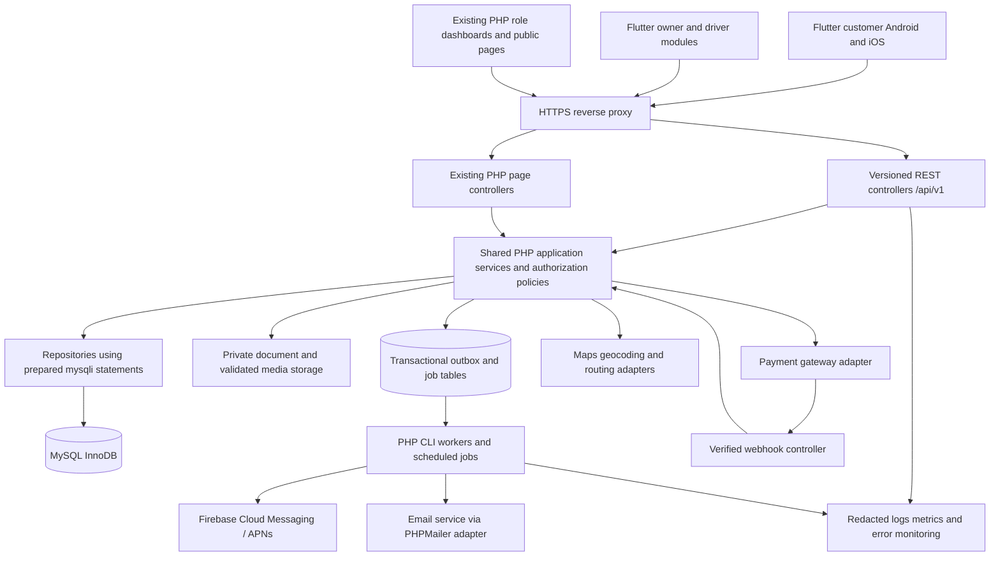

# CLEVO target architecture

Design date: 2026-11-15. Status: proposed design, not implemented. Read with [AUDIT_REPORT.md](AUDIT_REPORT.md), [FEATURE_INVENTORY.md](FEATURE_INVENTORY.md) and [MIGRATION_PLAN.md](MIGRATION_PLAN.md).

Subsequent implementation records: [SECURITY_CHANGES.md](SECURITY_CHANGES.md) and [DATABASE_CHANGES.md](DATABASE_CHANGES.md). The design below remains the original target, not a claim that all integrations exist.

## Architectural decision

Keep the application as a **PHP modular monolith backed by MySQL/InnoDB**. Add a versioned HTTPS REST API and Flutter Android/iOS clients incrementally. Existing Admin, Owner, User/customer and Driver PHP pages remain supported and call the same application services as the API after extraction. Preserve current web layouts, Arabic/English, RTL/LTR, and dark/light mode. No Node.js backend, Laravel adoption, framework rewrite, or wholesale database replacement is proposed.



MySQL remains authoritative for identities, permissions, bookings, payments, ledger events, plan entitlements and notifications. Push messages, mobile local state, browser local storage, provider redirects and GPS supplied by clients are not authoritative business state. Begin with database-backed jobs/outbox; add a queue/cache service only when measurements justify it. Redis is optional infrastructure, not a prerequisite or replacement for MySQL.

## PHP boundaries and reuse

The following is a proposed additive layout; the listed folders do not yet exist. Keep all existing URL entry points during migration.

| Boundary | Responsibilities | Existing starting points |
|---|---|---|
| API controllers and middleware | Route/method matching, bearer auth, content negotiation, bounded JSON parsing, request IDs, validation, response DTOs, rate limits | `api/index.php`; JSON response and cleaning helpers in `includes/config.php` |
| Auth service/policies | Registration, role allowlists, credential verification, approvals, reset grants, token sessions, object ownership | `general/login.php`, `general/register.php`, reset endpoints, `Emails/verify.php`; harden before extraction |
| Catalog/station service | Approved listings, station status/hours, bilingual services, prices, coverage, station ownership | `general/landing.php`, `user/search-stations.php`, `owner/add-station.php`, `owner/manage-services.php` |
| Booking service | Server quotes, immutable item snapshots, slot validation, lifecycle/deadlines, assignment and cancellation/reschedule | `includes/booking-helpers.php`, `user/station-details.php`, `owner/incoming-orders.php` |
| Payments/ledger service | Intent lifecycle, captures/refunds, wallet balances, points, commissions, owner liabilities, withdrawal reserves | Guarded wallet debit and calculation concepts in `includes/app-helpers.php`; current payment controller is a mock and cannot establish verified payment |
| Subscription service | Product versions, purchase snapshots, eligible coverage, consumption/restoration and expiry | `includes/plan-helpers.php`, `user/customer-plans.php`, `admin/manage-plans.php` |
| Driver/tracking service | Assignment ownership, authorized transitions, task-scoped location samples, stale state | Both existing driver controllers and `user/get_order_status.php`; merge their domain logic |
| Support/review service | Scoped conversations, retained messages, ratings, owner replies, guest contact | `includes/support-helpers.php`, user/admin support controllers and owner reviews; remove unsecured alternate behavior through compatibility adapters |
| Notifications/integrations | Localized event templates, per-recipient inbox, FCM tokens/delivery, email outbox, maps/chat adapters | Notification helpers, PHPMailer, expiry notifier; no current FCM implementation |
| Administration/reporting | Approvals, account restrictions, catalog moderation, payout review, reconciled reports, actor audit | Existing `admin/*.php`; web UI remains the initial admin client |

Proposed `src/Application`, `src/Domain`, `src/Infrastructure`, `src/Http`, `migrations`, `bin` and `tests` can be introduced one module at a time with Composer autoloading. Keep mysqli initially. Each mutation has one application-service entry point; controllers translate HTTP/form input and render responses only. Avoid a parallel set of mobile business rules.

## Identity and access

- Retain canonical roles `admin`, `owner`, `customer`, `driver`, mapping existing `Admin`, `User` and `user` aliases at the compatibility boundary. Split account verification, owner/station approval, and operational availability into distinct concepts; an active session cannot override a suspended account or blocked station.
- Preserve secure web sessions for existing pages. Set explicit cookie Secure/HttpOnly/SameSite, strict session handling and timeout policy; regenerate on login/privilege changes. Session-authenticated state changes require CSRF. Existing CSRF helpers are reusable after coverage gaps are fixed.
- Mobile login returns a short-lived JWT access token and an opaque rotating refresh token. A provisional access lifetime of 10-15 minutes and revocable refresh lifetime around 30 days should be tuned to operational needs. Store refresh token **hashes**, device/session identity, expiry and revocation in MySQL. Never return secrets through logs or URLs.
- Validate signature, algorithm, issuer, audience, subject, time claims and token/session/account version. Use a maintained PHP JWT package after dependency/security review; no backend framework change is required. Rotate signing keys with bounded overlap; invalidate current exposed signing material before rollout.
- On logout, password reset, ban or offboarding, revoke appropriate sessions/refresh families and invalidate outstanding access authority using session/account version checks. Refresh reuse revokes the family. Invalid explicit bearer credentials return 401; they must not silently fall back to another cookie identity.
- Keep mobile tokens in platform secure storage (Keychain/Android secure storage). Browser cookies and Flutter tokens are separate transport credentials for one policy model. Driver task codes become short-lived, hashed, attempt-limited grants bound to a driver and assignment, never a reusable shared driver password or unrestricted cross-task token.
- Password recovery: create challenge -> verify OTP -> issue short-lived single-use reset grant -> atomically consume grant and set strong password -> revoke sessions -> send a notification. Registration and reset use the same password rules. Email links use configured trusted origins, expire and are single-use.

| Resource/action | Customer | Owner | Driver | Admin |
|---|---|---|---|---|
| Approved catalog | Read | Read, manage owned station catalog | Read when needed for task | Moderate all |
| Booking | Create/read own, cancel/reschedule under policy | Read and act on owned stations | Read assigned task DTO only | Scoped support/oversight with audit |
| Driver assignment | None | Assign eligible driver to authorized station/task | Accept/view own assignment as policy allows | Oversight/offboard |
| Payment/wallet/points | Own intents, balances, redemption/refunds | Own earnings, bank account, withdrawals | Minimum payment-ready task flag | Reconcile and approve payouts; no arbitrary unlogged balance edits |
| GPS | Upload own saved location; read own active delivery | Read own active tasks | Upload only own active assignment | Explicit audited support access if required |
| Support/reviews | Own tickets; review own completed booking | Own tickets; reply to own station reviews | Own tickets | Ticket handling and moderation |
| Notifications | Own inbox/devices | Own inbox/devices | Own inbox/devices | Own inbox plus per-recipient admin events |

Object ownership is checked in SQL/repository and policy code for every identifier, not just at route login. Client-supplied role, owner ID, price, payment status and commission are never authority. Return only data needed by that role; exclude driver access codes, password/reset/verification fields, bank details and internal ledger metadata from unrelated DTOs.

## REST contract

Mount new endpoints at `/api/v1`. Existing `/api/index.php/stations` and `/api/index.php/bookings` are legacy compatibility endpoints and stay until separately scheduled deprecation. Initial adapters preserve their contracts while new clients use the versioned API. Configure forwarding of `Authorization` explicitly at the reverse proxy/PHP SAPI.

Publish an OpenAPI document before Flutter implementation, with examples for every response/error, role and pagination shape. The full feature-to-route mapping is in [FEATURE_INVENTORY.md](FEATURE_INVENTORY.md); these routes are **proposed**, not currently available.

```json
{
  "status": "success",
  "data": { "booking": { "id": 123, "status": "accepted", "version": 4 } },
  "message": "booking.accepted",
  "meta": { "request_id": "example-request-id" }
}
```

Errors use the same top-level shape, `data: null`, a stable message/code, optional field errors and request ID; never raw SQL or exception text. Preserve the existing helper's envelope only at legacy adapters. Suggested HTTP semantics: 201 created, 202 queued/processing, 204 when deliberately bodyless, 400 malformed JSON, 401 unauthenticated/expired, 403 forbidden, 404 unavailable object, 409 state/idempotency conflict, 422 field validation, 429 throttled with Retry-After, and redacted 5xx. Explicit 405/Allow and OPTIONS behavior are mandatory. Restrict browser CORS to configured origins; native Flutter networking does not depend on permissive browser CORS.

Use UTF-8 JSON, strict types, bounded request bodies and cursor pagination with deterministic `(created_at,id)` ordering; default 20, maximum 100 records. Return timestamps as UTC ISO 8601. Dates representing local appointments also carry the station timezone (`Asia/Amman` initially). Use stable machine enums and localization keys; send `ar/en` content where required. Legacy statuses such as `In Progress` and `Cancelled_Timeout` map to versioned machine values at adapters.

All money DTOs include currency and exact string amounts or integer minor units with documented exponent. **Do not assume two decimals is correct for all providers/currencies.** Select JOD precision and rounding deliberately with gateway documentation; preserve existing two-decimal historical values without revaluation. Server-side quotes lock item IDs/names/prices/discounts/commission/funding policy in a bounded lifetime. The client renders the quote and submits its ID, not a trusted total.

For booking creation, payments, plan purchases, redemption, cancellation/refunds and withdrawals, accept `Idempotency-Key`. Scope it by actor and operation; persist a request-body hash, state and result under a unique constraint. Same key/body returns the original result; key reuse with a different body returns 409. Use an expected version/state for lifecycle updates. This supports safe Flutter retries after an uncertain network outcome.

## Booking and financial invariants

### Lifecycle

Keep existing booking statuses during compatibility work. Establish a transition matrix per service mode rather than permitting every known target value.

| Mode | Proposed legal progression | Actor/conditions |
|---|---|---|
| At station | Pending -> Accepted -> In Progress -> Completed; direct Accepted -> Completed can remain if current operating policy needs it | Owner of approved station; payment recorded or explicit cash-collection policy |
| At customer location | Pending -> Accepted -> In Progress -> Completed | Authorized owner/operator; verified payment or plan authorization before dispatch/start |
| Pickup/delivery | Pending -> Accepted -> In Progress -> Arrived -> Pickup -> Washing -> Returning -> Completed | Owner assigns eligible driver; driver acts only on active assignment; verified payment/plan before dispatch |
| Decline/cancel/timeout | Pending -> Rejected/Cancelled/Cancelled_Timeout; Accepted -> timed-out only under unpaid deadline policy | Authorized owner/customer/worker as applicable; atomic release/refund/restore |

The precise `Arrived` versus `In Progress` order, cancellation after acceptance and cash collection require product confirmation in implementation phase; audit did not change existing behavior. Explicitly reject transitions from terminal states. Preserve compatibility values until every old page understands any new states. Persist `accepted_at`, `completed_at`, explicit response/payment deadlines and a version. Rescheduling creates a defined new response deadline; it must not reuse the old creation timestamp accidentally.

Before booking/rescheduling validate account/station approval and availability, selected services belonging to that station and mode, canonical future local datetime, hours/overnight closures, durations, capacity and service area. Validate geographic ranges and distinguish 0 from missing coordinates. Lock capacity or use an atomic reservation model so two requests cannot overbook the same resource. Define how much pending demand reserves capacity.

### Payment/ledger flow

1. Server creates a quote and a booking or plan/top-up purchase intent. Payment state is separate from booking state. No arbitrary `payment_method` input establishes payment.
2. Wallet/points/plan commands lock booking/entitlement and account resources in a consistent order; one DB transaction writes the financial event, balance/entitlement change, booking payment reference and outbox events. No schema DDL or remote network call occurs inside the transaction.
3. Card flow creates a provider intent using server-calculated amount/currency/reference and tokenized/hosted payment UI. The app may receive a redirect or SDK result, then reads status. It cannot assert success.
4. Webhook handling verifies the **raw payload** using the selected provider's authentication and freshness rules, checks merchant/reference/amount/currency/final status, stores the external event under a unique provider/event ID and commits the resulting financial state once. Authenticate before accepting an event for processing. A provider lookup may confirm uncertain states.
5. Persist and acknowledge durable receipt promptly, then process retryable work. Define state rules for duplicate/out-of-order events and late payment after booking timeout: reconcile and refund/rebook under policy, never silently reopen a terminal booking.
6. Settle owner earnings at the documented service/payment milestone, initially prefer verified completion plus captured funds. Maintain available, reserved and payable balances; plan/points subsidies have an explicit funding account. Commission and payout use immutable purchase/booking terms.
7. Refunds reference the original capture/debit and are individually idempotent. Card refunds normally use the processor; wallet credit substitution requires an explicit product policy and user consent where applicable. Restore points/plan usage once. Owner reserves/receivables cover reversals after payout. Never report completion while a refund is still pending externally.
8. Withdrawals reserve funds, require a verified bank profile, record the bank snapshot, actor and transfer reference, and transition through requested/approved/processing/paid/rejected/failed as needed. Admin marking `paid` is a manual disbursement record, not proof the bank transferred it. Reject/failure releases reserved funds once. Provide reconciliation before automated payouts.

Use an immutable journal with balanced debit/credit entries for material financial movements, typed references and a unique business event ID. Keep `wallet.Balance` as a reconciled projection during compatibility migration; update it and the new journal in the **same transaction**, not through asynchronous independent writes. Preserve `wallet_transactions` as legacy-readable history and map existing rows to migrated events with provenance/opening adjustments, never invent original captures.

Provider choice is intentionally open: confirm Jordan merchant eligibility, JOD settlement, refunds, 3DS, tokenization, mobile SDK/hosted checkout, webhook reliability and fees before selection. These are evaluation criteria, not a claim that any named gateway is available for CLEVO. [Stripe's webhook documentation](https://docs.stripe.com/webhooks) is a reference example for event signatures/retries; it is not a gateway selection.

## Incremental database design

Retain current primary keys and tables; add migrations and nullable columns/tables first. Use InnoDB, utf8mb4, explicit strict SQL configuration and supported MySQL version validation. Do not rename/drop legacy columns until old readers/writers are migrated. All additions below are **proposed**.

| Area | Additions / constraints | Compatibility and cleanup |
|---|---|---|
| Identity | Auth sessions/refresh families, reset challenges/grants, verification expiry, `auth_version`, separate email verification from station approval | Normalize role aliases at boundaries; invalidate exposed credentials; migrate old accounts through controlled verification/reset |
| Catalog | Archive flags/timestamps, station timezone/hours/coverage/capacity, explicit owner-station scope, localized categories | Keep existing names and AR/EN columns; derive API fields without redesigning current pages |
| Booking | `version`, `completed_at`, response/payment deadlines, payment-state reference, immutable quote/items and status/assignment event history | Backfill from known data with provenance; use the existing booking-services snapshots; retain old status strings through mapping |
| Financial | Payments/intents, provider events, refunds, ledger journals/entries, funding accounts, idempotency records, settlement and reserved funds | Reconcile balances and opening amounts first; unique provider IDs/operation IDs; preserve wallet projection and old history |
| Plans | Versioned products, purchased term snapshots, machine-readable eligible services/stations/modes/caps, consumption/reversal events | Retain remaining-wash UI and historic end dates; deactivate plans, retain purchased references |
| Notifications/jobs | Device registrations, per-recipient notification rows/reads, outbox/jobs, delivery attempts and dead-letter state | Backfill existing user notifications; fan out role messages deliberately; no sensitive push payloads |
| Location | Timestamp/accuracy/sequence/assignment on location samples; bounded latest-location projection | Continue writing `Driver_Lat/Driver_Lon` temporarily; add retention and delete/archive raw history under policy |
| Support/files/audit | Conversation status/closed timestamps, attachment authorization metadata, immutable actor actions with entity references | Preserve existing messages and legacy fallback; stop deletion only as an intentional approved behavior change |

Reconcile duplicate wallets before `UNIQUE(wallet.UserID)`; define whether loyalty represents a balance or buckets before enforcing its cardinality. Add unique booking references and financial-event identities, nonnegative balance/bounded rating checks where supported, and history-preserving deletion rules. Enforce service/driver/subscription ownership invariants in services and add feasible relational constraints. Document any intentionally unenforced cross-table invariant.

Candidate indexes, to be verified with EXPLAIN and representative cardinalities: booking `(UserID,created_at,BookingID)`, `(StationID,Status,created_at)`, `(DriverID,Status,created_at)`, deadline scans `(Status,response_deadline)`/`(Status,payment_deadline)`, notifications `(recipient_id,is_read,created_at,id)`, wallet history `(WalletID,CreatedAt,TransactionID)`, active plans `(user_id,status,end_date,id)`, jobs `(status,available_at,id)`, support messages `(TicketID,CreatedAt,MessageID)`. Avoid indexing every field blindly.

## Integrations

| Integration | Backend contract | Flutter/operational requirements |
|---|---|---|
| Firebase Cloud Messaging | Authenticated register/update/delete device endpoint; store user/session/platform/token/locale; outbox delivery through HTTP v1 with protected server credentials; retry transient errors, retire invalid tokens | Configure Firebase projects per environment, Android permissions, iOS APNs credentials/capabilities and foreground/background handlers; token rotation and logout removal; re-fetch authorized state after push |
| Maps/GPS | Provider interfaces for reverse geocoding/routing/search; credential restrictions, caching, quotas, timeouts and attribution; active assignment location endpoint; stale/null location semantics | Platform location consent, foreground/background disclosure and battery-aware collection; permission denied/offline/stale UI; no background tracking outside active tasks; test device suspension and revocation |
| Payments | Intent/capture/refund adapter, signature-verified webhook, event deduplication, reconciliation, provider timeouts | Hosted/tokenized SDK, 3DS/external-browser/app-link return; app resumes by fetching server status; no card data in CLEVO logs/storage |
| Email | Shared PHPMailer service using a configured transactional provider, queued templates, trusted public URL, delivery retry/attempt status and resend flow | Verification/reset deep links and browser fallback; localized templates; provider SPF/DKIM/DMARC and bounce handling verified during deployment |
| Monitoring/logging | Structured request/actor/entity IDs, redacted exceptions, payment/queue/deadline metrics, alert routing and audit trail | Mobile crash/error/performance telemetry with minimum necessary identifiers and release tags; redact tokens, card/bank data, passwords, OTPs and precise location |
| Lamea chat/weather/translation | Retain existing features through bounded adapters; authenticate chat identity server-side and isolate guests; cache public weather; use stored bilingual content rather than sending personal names to translate on every render | Preserve chat UX and provide optional native voice input only after platform/permission testing; expose provider failure states without blocking booking |

FCM requires a trusted server environment and protected credentials/tokens; use the [HTTP v1 server API](https://firebase.google.com/docs/cloud-messaging/send/v1-api). Flutter's [platform setup guide](https://firebase.google.com/docs/cloud-messaging/flutter/get-started) covers native prerequisites. Push is a prompt to refresh authoritative state; do not put driver login codes, bank details or exact customer coordinates in notification previews. Public Nominatim usage must fit its [usage policy](https://operations.osmfoundation.org/policies/nominatim/); a commercial routing/geocoding arrangement or controlled instance is preferable to unbudgeted browser calls at marketplace scale.

## Flutter application structure

Start with one shared Flutter codebase: design/localization/theme tokens, API client, auth/session manager, feature repositories, domain models and role-specific feature modules. Release customer and operations applications separately if distribution/permissions warrant it; share packages and API contracts. Preserve all roles even if Admin continues primarily on the existing web dashboard.

- Presentation widgets/controllers are separated from network/secure storage. Use a consistent state-management approach chosen at implementation kickoff; avoid binding widgets to legacy PHP HTML or direct SQL.
- Feature modules: onboarding/auth/recovery; catalog/search; profile/location; booking/quote/history/details; payment/wallet/loyalty/plans; support/reviews; inbox; owner stations/services/drivers/orders/earnings; driver assignments/tracking/status.
- Store theme (`system/light/dark`) and locale locally; use ARB catalogs and Flutter localization/RTL support. Expose equivalent user choices without unnecessary redesign. Snapshot-test Arabic/English, both themes, long content and accessibility text scaling.
- Generate typed models/client from the approved OpenAPI contract where practical. Centralize error mapping, 401 refresh with a single-flight refresh operation, retries with backoff and idempotency keys, cursor pagination and upload limits.
- Cache catalog/history for reading with explicit freshness. Queue only safe idempotent commands where policy permits; never display an offline payment as settled or confirm a booking without server acknowledgement.
- Register app/universal links for verification, recovery and payment return. After link handling, fetch server state. Test cold start, background resume, expired links and a different signed-in user.
- CI must build/test Android and iOS with environment-specific identifiers/configuration and protected signing credentials. Physical-device tests are required for push, location, permissions, payment return and process termination.

## Production boundary and rollout

Serve public entry points through HTTPS with explicit trusted hosts/proxies; protect admin paths with strong authentication, rate limiting and audited privileges. Keep MySQL private. Expose only an allowlisted document root/entry routes and validated public media. Deny SQL dumps, VCS/editor/config/dependency metadata and CLI workers. Private verification documents and bank data require authorization and protected storage/backups.

Use distinct dev/staging/production databases, service credentials and Firebase/payment projects. Pin a supported patched PHP runtime and required extensions. Configure secure cookies, HTTPS forwarding, restrictive browser CORS, headers, upload limits, error display disabled and redacted structured logs. Runtime DB grants exclude DDL after migrations replace `clevoEnsure*` mutations. Use a separate migration principal. Production installation must not import demo accounts or run the destructive `clevo.sql` bootstrap.

Schedule booking deadlines, subscription expiry, outbox delivery and reconciliation independently of page views. Workers claim jobs atomically, have bounded retries/backoff/leases, expose dead-letter failures and safely resume after a crash. A job's business effect must remain idempotent beyond the queue retry mechanism.

Measure request latency/error rate, DB slow queries, queue lag, stale driver locations, timeout delays, payment-versus-ledger discrepancies, failed refunds, pending withdrawals and email/push failure rates. Protect sensitive audit events; set backup encryption, retention, restore procedure, RPO/RTO and alert ownership during deployment design. Provisional service objectives can be agreed after a baseline load test; this audit establishes no throughput SLA.

Roll out repaired shared services behind feature flags, compare results on anonymized data, preserve web contracts and then release mobile features by cohort. Rollback disables new routes/flags and returns to a **verified safe** application build; it must not re-enable known critical defects or roll financial data back behind confirmed external captures. Additive migrations stay in place until independently verified cleanup windows.
